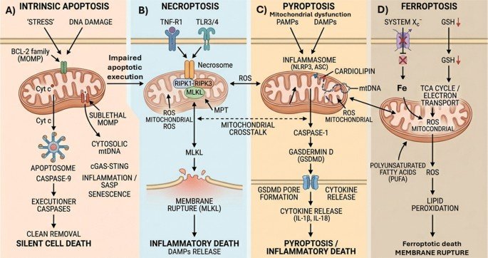
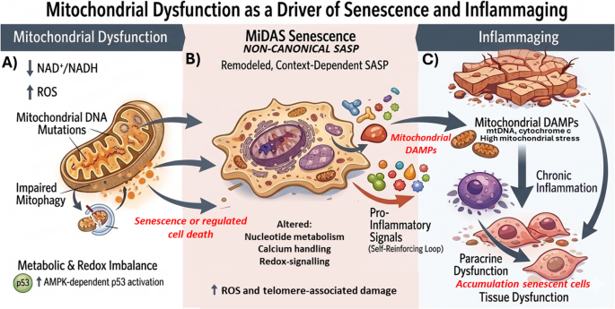

## Abstract

Ageing is characterized by a progressive decline in [[Mitochondrial Integrity|mitochondrial integrity]] that extends beyond impaired energy production to include redox imbalance, defective quality control, altered organelle dynamics, and persistent inflammatory signalling. This review examines [[Mitochondrial Dysfunction|mitochondrial dysfunction]] as a mechanistic bridge linking bioenergetic failure to [[Cellular Senescence|cellular senescence]] and [[Inflammaging|inflammaging]], two central features of biological ageing. We discuss how impaired [[Oxidative Phosphorylation|oxidative phosphorylation]], loss of [[Mitochondrial Membrane Potential|mitochondrial membrane potential]], increased electron leak, and excessive [[Reactive Oxygen Species|reactive oxygen species]] progressively damage [[Mitochondrial DNA|mitochondrial DNA]], proteins, and lipids, thereby amplifying organelle dysfunction and compromising cellular homeostasis. Particular emphasis is placed on the threshold effect of [[Mitochondrial DNA|mtDNA]] mutations, whose age-dependent clonal expansion can drive respiratory chain deficiency in vulnerable tissues. We further analyze [[Mitochondria]] as signalling platforms that integrate [[Regulated Cell Death|regulated cell death]], including [[Apoptosis|apoptosis]], [[Necroptosis|necroptosis]], [[Pyroptosis|pyroptosis]], and [[Ferroptosis|ferroptosis]], and as sources of [[Damage-Associated Molecular Patterns|mitochondrial damage-associated molecular patterns]] promoting sterile inflammation. Finally, we highlight [[Mitochondrial Dysfunction-Associated Senescence|mitochondrial dysfunction-associated senescence]] as a central process through which persistent mitochondrial stress reshapes the [[SASP|senescence-associated secretory phenotype]] and reinforces inflammaging. Overall, the evidence supports a model in which dysfunctional mitochondria act as both initiators and amplifiers of senescence and inflammation, contributing to tissue degeneration and age-related functional decline. Understanding these interconnected mechanisms may help identify therapeutic strategies targeting mitochondrial bioenergetics, inflammatory signalling, and senescent cell burden in ageing.

> [!info] Central Thesis
> Dysfunctional mitochondria act as both initiators and amplifiers of senescence and inflammation, coupling bioenergetic failure to [[Mitochondrial Dysfunction-Associated Senescence|MiDAS]], [[Damage-Associated Molecular Patterns|mitochondrial DAMP]] sensing, [[Regulated Cell Death|regulated cell death]], and chronic sterile inflammation ([[Inflammaging]]).

## Introduction

[[Mitochondria]] are central integrators of cellular energetics, redox homeostasis, and stress signalling; therefore, their dysfunction is a recurrent feature of both pathological conditions and physiological ageing. Under normal conditions, the [[Mitochondrial Electron Transport Chain|mitochondrial electron transport chain]] couples substrate oxidation to [[Oxidative Phosphorylation|oxidative phosphorylation (OXPHOS)]] and ATP synthesis [^1]. However, electron transfer alteration is intrinsically linked to [[Reactive Oxygen Species|reactive oxygen species (ROS)]] generation [^2]. Indeed, when respiratory efficiency declines, this balance shifts toward bioenergetic failure and oxidative stress. In this setting, impaired OXPHOS reduces ATP output while increasing electron leak, thereby amplifying ROS production and initiating a vicious cycle in which oxidants further damage [[Mitochondrial DNA|mitochondrial DNA (mtDNA)]], lipids, and proteins, progressively worsening respiratory dysfunction. Within the framework of ageing biology, [[Mitochondrial Dysfunction|mitochondrial dysfunction]] and [[Cellular Senescence|cellular senescence]] are now recognized as interconnected hallmarks rather than isolated phenomena [^3], becoming immunometabolic and inflammatory hubs. Oxidative stress does not merely impair mitochondrial biochemistry; it also remodels mitochondrial architecture. [[Mitochondrial Integrity]] depends on the dynamic balance between [[Mitochondrial Fusion|fusion]] and [[Mitochondrial Fission|fission]], which preserves [[Mitochondrial Membrane Potential|membrane potential]], distributes metabolites, and segregates damaged organellar components. Disruption of these quality-control processes, i.e. fission vs fusion and biogenesis of mitochondria, alters mitochondrial morphology, often producing fragmented or, in some contexts, pathologically elongated mitochondria with defective membrane potential and increased ROS generation. Experimental evidence indicates that sustained abnormalities in [[Mitochondrial Dynamics|mitochondrial dynamics]] are sufficient to induce senescence-associated phenotypes, linking structural derangement of the organelle to persistent cell-cycle arrest and stress signalling [^4]. Consistently, reviews of mitochondrial dysfunction in senescence define the phenotype operationally by reduced respiratory capacity and membrane potential, usually accompanied by increased ROS production, underscoring that structural and functional failure evolve together [^5].

Once mitochondrial damage exceeds compensatory capacity, the consequences extend beyond metabolic insufficiency. Dysfunctional mitochondria can trigger intrinsic [[Apoptosis|apoptosis]] through [[Mitochondrial outer membrane permeabilization|mitochondrial outer or inner membrane permeabilization]], but they can also promote inflammatory forms of signalling associated with [[Necroptosis|necroptosis]], [[Pyroptosis|pyroptosis]], or caspase-limited apoptosis. A key event is the release or exposure of [[Damage-Associated Molecular Patterns|mitochondrial damage-associated molecular patterns (DAMPs)]], including mtDNA, ROS, [[Cardiolipin|cardiolipin]], [[N-Formyl Peptides|N-formyl peptides]], and other mitochondria-derived molecules that retain bacterial-like immunogenic features. These signals engage pattern-recognition pathways such as [[Toll-like Receptor|Toll-like receptors (TLRs)]], the [[NLRP3 inflammasome]], and [[cGAS-STING Pathway|cyclic GMP–AMP synthase (cGAS)–stimulator of interferon genes (STING)]], thereby converting mitochondrial injury into sterile [[Inflammation|inflammation]] [^6, ^7]. Thus, damaged mitochondria act not only as failing bioenergetic units but also as inflammatory organelles capable of propagating tissue dysfunction far beyond the initially injured cell [^8].

This transition from mitochondrial dysfunction to cellular senescence is particularly relevant in ageing tissues. [[Mitochondrial Dysfunction-Associated Senescence|Mitochondrial dysfunction-associated senescence (MiDAS)]] demonstrates that direct impairment of mitochondrial function can induce stable growth arrest together with a distinct secretory phenotype, thereby providing a mechanistic bridge between mitochondrial failure and the accumulation of [[Senescent Cells|senescent cells]] in aged organisms [^9]. [[Senescent Cells|Senescent cells]], in turn, sustain a chronic pro-inflammatory milieu through secreted [[Cytokines|cytokines]], [[Chemokines|chemokines]], proteases, and alarmins, while defective [[Mitochondrial Quality Control|mitochondrial quality control]] favours continued ROS production and further DAMP release. In ageing, these cell-autonomous and non-cell-autonomous loops converge into the state termed [[Inflammaging|inflammaging]], namely, a chronic, sterile, low-grade inflammatory condition that accompanies ageing and contributes to age-related tissue degeneration and disease susceptibility [^10]. In this sense, mitochondrial dysfunction is both a driver and an amplifier of inflammaging, because it promotes senescence, fuels sterile inflammation, and undermines tissue repair capacity.

Previous reviews have established the reciprocal relationships between mitochondrial dysfunction, cellular senescence, and inflammatory signalling [^5, ^11, ^12]. Indeed, it has been examined how mitochondrial injury produces different combinations of growth arrest, inflammatory activity, and regulated cell death. We organize this synthesis around three interacting determinants: bioenergetic and redox status, mitochondrial membrane integrity, and the release and compartment-specific sensing of mitochondrial DAMPs. This perspective connects metabolic regulation of MiDAS with evidence that sublethal engagement of the mitochondrial apoptosis machinery can sustain inflammatory signalling without eliminating the affected cell [^9, ^13]. The specific contribution of this review is to distinguish the mechanisms controlling senescence-associated growth arrest from those governing inflammatory amplification, while examining how their interaction may contribute to tissue dysfunction during ageing. We present this organization as an interpretative framework rather than a newly established pathway or an obligatory sequence of events. While mitochondrial dysfunction, cellular senescence, and mtDAMP-driven inflammation represent the central axis discussed in this review, their biological impact is inseparable from other [[Hallmarks of Aging|hallmarks of ageing]] [^14, ^14]. Mitochondrial impairment can aggravate genomic instability through ROS-mediated DNA damage. At the same time, [[Epigenetic Alterations|epigenetic alterations]] modulate the expression of genes controlling [[Mitochondrial Biogenesis|mitochondrial biogenesis]] and loss of [[Proteostasis|proteostasis]], and defective [[Autophagy|autophagic]] or [[Lysosome|lysosomal]] function limits the clearance of damaged mitochondrial components, thereby enhancing mtDAMP release, inflammasome activation, and persistence of the senescence-associated secretory phenotype [^15,^16,^17]. These reciprocal interactions support the view that the mitochondrial dysfunction-senescence-inflammation axis functions as a central node through which multiple hallmarks converge and amplify tissue ageing [^11]. The following sections will therefore examine, in molecular detail, how mitochondrial dysfunction progresses from defects in respiratory activity, redox control, dynamics, and quality surveillance to the establishment of the senescent phenotype and, ultimately, to organismal ageing and inflammaging.

## Mitochondrial homeostasis in ageing: from bioenergetic decline to genome mutagenesis

Mitochondrial dysfunction is a progressive and self-amplifying process in which primary defects of OXPHOS are coupled to structural and redox deterioration of the organelle. When [[Mitochondrial Electron Transport Chain|electron transport chain]] efficiency declines, proton pumping across the [[Inner Mitochondrial Membrane|inner mitochondrial membrane]] becomes less effective, leading to reduced [[Mitochondrial Membrane Potential|mitochondrial membrane potential]], impaired ATP synthase activity, and lower ATP output [^2]. In parallel, defective electron transfer increases electron leak, particularly at [[Complex I|complexes I]] and [[Complex III|III]], thereby enhancing [[Mitochondrial ROS|mitochondrial ROS]] generation. Excess ROS then damage mitochondrial lipids, the respiratory chain, and mtDNA, further compromising OXPHOS and reinforcing a vicious cycle of bioenergetic failure and oxidative stress [^18]. This cumulative damage progressively alters cellular homeostasis, affecting [[Calcium|Ca²⁺]] handling, mitochondrial dynamics, stress signalling, and ultimately cell viability. The result is not an abrupt energetic collapse, but rather a gradual decline in mitochondrial performance that predisposes tissues to dysfunction during ageing [^19].

A key principle underlying mtDNA-linked mitochondrial dysfunction is that most pathogenic human mtDNA mutations behave as functionally recessive at the cellular level. This does not refer to Mendelian recessiveness, but to the fact that mutant mtDNA molecules usually coexist with wild-type genomes in the same cell, a condition known as [[Heteroplasmy|heteroplasmy]]. As long as the proportion of wild-type genomes remains sufficient to sustain mitochondrial transcription, [[Mitochondrial Translation|translation]], and respiratory chain assembly, OXPHOS function can be preserved through intracellular complementation. Consequently, most pathogenic mtDNA variants do not produce a biochemical defect until mutant genomes exceed a critical threshold. This “threshold effect” is a defining feature of mitochondrial genetics and explains why the same mtDNA mutation can remain clinically silent at low levels yet become pathogenic when its proportion rises beyond a mutation- and tissue-specific level [^20]. Importantly, this threshold is not fixed. It depends on the pathogenic severity of the variant, the affected mtDNA gene, the energetic demand of the tissue, and the absolute mtDNA copy number per cell. In addition, the absolute number of wild-type mtDNA copies can modulate penetrance: a cell with high total mtDNA copy number may better buffer a given heteroplasmic burden than a cell with fewer genomes, even at similar mutant percentages [^19].

> [!important] Threshold Effect
> Most pathogenic human mtDNA mutations are functionally recessive at the cellular level: OXPHOS is preserved by [[Mitochondrial Fusion|fusion]]-based complementation until mutant genomes exceed a mutation- and tissue-specific threshold, after which respiratory-chain deficiency emerges ([[Heteroplasmy]]).

This concept is particularly relevant to ageing. Studies of human tissues support an association between age-related clonal expansion of mtDNA mutations and focal respiratory-chain deficiency. For example, analysis of colorectal biopsies from 207 individuals aged 17–78 years linked ageing to an increased frequency of clonally expanded mtDNA mutations and respiratory-chain-deficient crypts [^21]. These findings support a contribution of mtDNA clonal expansion to mitochondrial dysfunction in human colonic epithelium. However, the cross-sectional design does not directly track mutation expansion within individuals or establish that these changes cause systemic inflammaging or organismal functional decline. The consequences of a given mutation burden depend on the variant, tissue, mtDNA copy number, and metabolic context [^19, ^20]. Respiratory deficiency should therefore not be interpreted as evidence that all downstream consequences, including increased ROS production, senescence, and inflammatory activation, necessarily occur in the same cells. Modelling and single-cell analyses further suggest that many of the mutations that later dominate aged cells may arise relatively early in life and then slowly expand over decades until they exceed the threshold for OXPHOS failure [^21]. In ageing, the threshold effect provides a mechanistic bridge between stochastic mtDNA mutagenesis and phenotypic decline. Somatic mtDNA mutations remain functionally silent while below threshold, but once clonal expansion drives mutant load past the level compatible with respiratory competence, OXPHOS defects emerge, membrane potential falls, ATP synthesis declines, and ROS production rises. These changes amplify damage to mtDNA and mitochondrial proteins, propagate further mitochondrial dysfunction, and progressively undermine cellular function. In this way, ageing can be viewed not simply as the accumulation of mtDNA mutations per se, but as the age-dependent increase in the number of cells in which mutant mtDNA has crossed the critical threshold required to convert genetic heteroplasmy into overt bioenergetic pathology [^19, ^20].

Mitochondrial quality control influences whether mitochondrial damage is contained or persists. [[Mitochondrial Fusion|Fusion]] and [[Mitochondrial Fission|fission]] coordinate network remodelling and segregation of damaged components, while mitochondrial chaperones, proteases, and biogenesis support protein homeostasis and organelle renewal. [[Mitophagy]] selectively delivers mitochondria to [[Lysosome|lysosomes]] through mechanisms including [[PINK1]]-[[Parkin]] signalling and receptor-mediated pathways. However, effective clearance requires completion of lysosomal degradation: impaired acidification or proteolytic activity can limit mitochondrial turnover despite activation of upstream mitophagy signals [^22]. Increased abundance of autophagy markers should therefore not be equated with increased degradative flux. [[Mitochondrial-Derived Vesicles|Mitochondrial-derived vesicles]] provide an additional route for selective cargo disposal and can influence the release of mitochondrial DAMPs. In experimental macrophage systems, mitophagic clearance of damaged mitochondria restrains [[NLRP3 inflammasome|NLRP3 inflammasome]] activation [^23]. Failure of these protective mechanisms may therefore favour persistent mitochondrial stress and inflammatory amplification, although their contribution to physiological ageing varies with tissue and experimental context.

## Mitochondria and ageing as platforms for regulated cell death

Mitochondria are now recognized as integrative hubs for [[Regulated Cell Death|regulated cell death]] rather than organelles restricted to intrinsic [[Apoptosis|apoptosis]]. In ageing, this concept is especially relevant because dysfunctional mitochondria do not usually activate a single, isolated death programme; instead, they generate a permissive state characterized by ATP decline, redox imbalance, impaired mitophagy, membrane remodelling, and release of mitochondrial danger signals that can feed into multiple execution pathways. Thus, [[Apoptosis|apoptosis]], [[Necroptosis|necroptosis]], [[Pyroptosis|pyroptosis]], and [[Ferroptosis|ferroptosis]] are better interpreted as partially overlapping programmes that share common mitochondrial determinants but differ in their terminal effectors and inflammatory consequences. Intrinsic apoptosis remains the most clearly mitochondria-centred programme because [[Mitochondrial outer membrane permeabilization|mitochondrial outer membrane permeabilization (MOMP)]] enables [[Cytochrome c|cytochrome ''c'']] release and caspase activation. However, recent work has made clear that mitochondrial apoptotic signalling is not binary. In cultured human fibroblast models of senescence, [[Minority MOMP|minority MOMP]] enables [[BAX]]/[[BAK]]-dependent mtDNA release and [[cGAS-STING Pathway|cGAS–STING]]-mediated [[SASP|SASP]] regulation without cell death. Genetic and pharmacological interventions further support a contribution of this mechanism to inflammatory phenotypes and selected functional outcomes in aged mice [^13]. These findings provide causal evidence within the investigated cellular and murine systems. They do not yet establish the prevalence or quantitative contribution of minority MOMP to physiological human ageing.

[[Necroptosis|Necroptosis]] shares with apoptosis several upstream stress contexts but diverges in execution, relying on [[RIPK1]]-[[RIPK3]] signalling and [[MLKL]]-mediated membrane disruption [^24]. Here too, mitochondria are best regarded not as universally obligatory effectors but as major contextual amplifiers. [[Mitochondrial ROS|Mitochondrial ROS]], metabolic failure, [[Mitochondrial Permeability Transition|mitochondrial permeability transition (MPT)]], and defective mitophagy can all lower the threshold for necroptotic injury, while [[necrosome|necrosome]] organization itself reflects a highly ordered signalling architecture rather than an accidental collapse of cellular energetics. Importantly, the border between apoptosis and necroptosis is mechanistically porous: [[Caspase-8]] activity can suppress necroptosis, whereas impaired apoptotic execution may redirect the stressed cell toward necroptotic rupture and stronger inflammatory output. This distinction is highly relevant in ageing tissues, where declining proteostatic and metabolic resilience favours inflammatory death over immunologically silent clearance. Age-associated disorders provide direct support for the pathological significance of RIPK3-dependent programmes in chronic degenerative settings, further indicating that necroptosis contributes to ageing not only through cell loss but also through sustained sterile inflammation [^25].

A similar logic applies to [[Pyroptosis|pyroptosis]] and [[Ferroptosis|ferroptosis]], which differ in proximal triggers but converge with the other pathways at the level of mitochondrial stress (Fig. [1](https://link.springer.com/article/10.1007/s11357-026-02588-y#Fig1)). In pyroptosis, inflammasome activation is tightly connected to mitochondrial dysfunction: oxidant generation, [[Cardiolipin|cardiolipin]] exposure, and mitochondrial recruitment of inflammasome components facilitate [[NLRP3]] activation, while mitochondrial damage intensifies [[Caspase-1]]-dependent inflammatory execution. Experimental evidence shows that NLRP3 and caspase-1 interact with cardiolipin and assemble on mitochondrial membranes, supporting the view that mitochondria function as supramolecular organizing centres for pyroptotic signalling [^26]. At the execution phase, however, the decisive effectors are the gasdermins, especially [[Gasdermin D|gasdermin D (GSDMD)]], which is cleaved by inflammatory caspases downstream of canonical and non-canonical inflammasome activation. After proteolytic cleavage, their N-terminal fragments form large membrane pores that drive [[IL-1β]] and [[IL-18]] release, ionic imbalance, cell swelling, and eventual cell lysis. This is particularly relevant in ageing because it transforms mitochondrial stress signals into overt inflammatory tissue injury, thereby sustaining sterile inflammation and [[Inflammaging|inflammaging]]. Importantly, GSDMD can also act on mitochondrial membranes in a cardiolipin-dependent manner, promoting depolarization, ROS production, mitochondrial permeabilization, and release of mitochondrial DAMPs, which further amplify pyroptotic signalling [^27]. Other family members, especially [[Gasdermin E|GSDME]], expand this network by linking [[Caspase-3]]-mediated apoptosis to secondary pyroptosis. In ageing tissues, where chronic stress and impaired proteostasis favour overlapping death pathways, gasdermins therefore act not simply as terminal effectors, but as key amplifiers coupling mitochondrial dysfunction to chronic inflammatory degeneration [^28]. [[Ferroptosis|Ferroptosis]], by contrast, is defined by iron-dependent phospholipid peroxidation rather than pore formation by caspases or MLKL, yet it is likewise deeply linked to mitochondrial metabolism [^29]. Tricarboxylic acid cycle activity, [[Mitochondrial Electron Transport Chain|electron transport]], ROS production, and impaired detoxification of lipid hydroperoxides all modulate ferroptotic sensitivity. In ageing, this is especially important because aged mitochondria frequently exhibit redox imbalance, altered [[Iron|iron]] homeostasis, and compromised antioxidant buffering, conditions that sensitize cells to ferroptotic damage while also promoting inflammatory mediator release.

**Fig. 1**

[Full size image](https://link.springer.com/article/10.1007/s11357-026-02588-y/figures/1)

Distinct mitochondrial contributions to regulated cell death and inflammatory signalling. The schematic illustrates four regulated cell death pathways and their differing relationships with mitochondrial function. **A** Intrinsic apoptosis: Cellular stress and DNA damage can promote [[Mitochondrial outer membrane permeabilization|MOMP]], enabling cytochrome c release, [[Apoptosome|apoptosome]] assembly, [[Caspase-9]] activation, and subsequent activation of executioner caspases. Apoptotic cells are generally cleared with limited inflammation when efferocytosis is efficient. A separate sublethal branch illustrates [[Minority MOMP|minority MOMP]], in which permeabilization of a subset of mitochondria permits cytosolic mtDNA release and [[cGAS-STING Pathway|cGAS–STING]] activation, contributing to [[SASP|senescence-associated secretory phenotype (SASP)]] regulation without necessarily causing cell death. **B** Necroptosis: [[RIPK3]]-dependent activation of [[MLKL|mixed lineage kinase domain-like protein (MLKL)]] promotes plasma membrane permeabilization and the release of [[Damage-Associated Molecular Patterns|DAMPs]]. [[RIPK1]] participates in selected upstream signalling contexts. [[Mitochondrial ROS|Mitochondrial reactive oxygen species (ROS)]] and [[Mitochondrial Permeability Transition|mitochondrial permeability transition (MPT)]] may modulate this pathway in particular experimental settings but are not universally required for its execution. **C** Pyroptosis: The canonical [[NLRP3]] inflammasome pathway activates [[Caspase-1]], which processes pro-[[IL-1β]] and pro-[[IL-18]] and cleaves [[Gasdermin D|gasdermin D (GSDMD)]]. GSDMD pores permit cytokine release and can lead to pyroptotic cell death. Mitochondrial signals, including ROS, [[Cardiolipin|cardiolipin]] redistribution, and mtDNA release, can facilitate or amplify these responses. D) Ferroptosis: Iron-dependent peroxidation of polyunsaturated fatty acid-containing phospholipids causes lethal membrane damage when lipid peroxide defence systems are insufficient. Inhibition of system Xc⁻ can reduce cystine availability and [[Glutathione|glutathione (GSH)]] synthesis, increasing susceptibility to ferroptosis. Mitochondrial metabolism contributes in a stimulus-dependent manner. Inter-panel connections represent potential interactions between pathways rather than universal mitochondrial dependence. Their contribution to persistent inflammation during ageing depends on the cellular and tissue context

Mitochondria contribute differently to these forms of regulated cell death. In intrinsic apoptosis, [[Mitochondrial outer membrane permeabilization|mitochondrial outer membrane permeabilization]] releases [[Cytochrome c|cytochrome c]] and enables apoptosome-dependent caspase activation. Necroptosis is executed through RIPK3-dependent activation of MLKL and can proceed independently of mitochondria, although mitochondrial processes may modulate its progression in particular settings. Pyroptosis is executed by gasdermin pores; mitochondrial signals can facilitate selected inflammasome responses, while gasdermin-mediated mitochondrial damage can amplify execution [^26, ^27]. Ferroptosis is defined by iron-dependent phospholipid peroxidation, with mitochondrial involvement varying according to the initiating stimulus and metabolic context. For example, mitochondrial metabolism supported cysteine-deprivation-induced ferroptosis but was dispensable following direct [[GPX4]] inhibition in the experimental systems examined. Mitochondria should therefore be considered pathway-specific participants rather than universal regulators of regulated cell death.

## Mitochondrial DAMPs and their sensing: from organelle damage to sterile inflammation in ageing

Mitochondrial damage is converted into inflammation not only through bioenergetic failure, but also through the generation and release of [[Damage-Associated Molecular Patterns|mitochondrial DAMPs]], which function as endogenous danger signals because of the bacterial ancestry of the organelle. The most relevant DAMPs include cell-free mtDNA, [[Mitochondrial RNA|mitochondrial RNA species]] including double-stranded RNA, [[Cardiolipin|cardiolipin]], [[N-Formyl Peptides|''N''-formyl peptides]], and [[Mitochondrial ROS|mitochondrial ROS]], which often act less as classical ligands than as potent danger amplifiers. Collectively, these signals link mitochondrial dysfunction to [[Innate Immune System|innate immune]] activation, sterile inflammation, and chronic tissue damage, making them highly relevant to ageing and age-related disease [^30]. A key point is that mitochondrial DAMP biology depends not only on the identity of the molecule but also on the mechanism of its release. mtDNA and mtRNA can escape when mitochondrial membranes become permeable during stress, apoptosis-associated MOMP, MPT, or defective mitochondrial quality control. Their release is also favoured when [[Mitophagy|mitophagy]] fails, allowing damaged mitochondria to persist and leak immunogenic components into the cytosol or extracellular space. In parallel, [[Mitochondrial-Derived Vesicles|mitochondrial-derived vesicles]] and [[Extracellular Vesicles|extracellular vesicles]] can export selected mitochondrial cargo, including nucleic acids and proteins, thereby extending inflammatory signalling beyond the injured cell [^31]. This means that mitochondrial DAMP release can be either uncontrolled, as in overt cell lysis, or actively packaged and propagated through vesicular trafficking, with distinct consequences for local and systemic inflammation.

Among mitochondrial DAMPs, extracellular or cytosolic mtDNA is probably the best characterized. Because mtDNA is circular, [[CpG Islands|CpG-rich]], and poorly protected once displaced from the [[Mitochondrial Matrix|mitochondrial matrix]], it is readily sensed as a danger signal. Endosomal [[TLR9]] recognizes DNA motifs enriched in unmethylated CpG sequences and can therefore respond to released mtDNA, particularly in inflammatory and tissue-damage settings [^32]. In the cytosol, ectopic mtDNA activates the [[cGAS-STING Pathway|cGAS–STING pathway]], leading to [[TBK1]]-[[IRF3]] and [[NF-κB|NF-kB]] signalling and the induction of [[Type I Interferon|type I interferon]] and inflammatory gene programmes [^33]. This pathway is now considered a major route by which mitochondrial stress is translated into sterile inflammation and senescence-related immune activation. [[Mitochondrial RNA|Mitochondrial RNA]] contributes an additional layer of immunogenicity. Under homeostatic conditions, mitochondrial RNA is compartmentalized and efficiently processed, but mitochondrial stress may expose mtRNA, including double-stranded species, to innate immune sensors. These RNA species can engage antiviral-like pathways, reinforcing the concept that damaged mitochondria mimic microbial signatures and activate innate immunity even in the absence of infection [^33]. This is mechanistically relevant because ageing is characterized by declining mitochondrial quality control and increased accumulation of damaged organelles, conditions that facilitate persistent nucleic acid leakage and inflammaging.

Other mitochondrial DAMPs act through complementary mechanisms. [[Cardiolipin]], normally confined to the [[Inner Mitochondrial Membrane|inner mitochondrial membrane]], becomes exposed or redistributed during mitochondrial stress and can directly participate in inflammasome signalling. [[NLRP3]] and [[Caspase-1]] have been shown to associate with cardiolipin-rich mitochondrial membranes, indicating that mitochondria are not merely the source of inflammatory ligands but also a platform for inflammasome assembly [^26]. [[N-Formyl Peptides|''N''-formyl peptides]] derived from mitochondrial translation products signal through [[Formyl Peptide Receptor|formyl peptide receptors]], thereby recruiting and activating innate immune cells in a manner analogous to bacterial peptides. They are not always classical receptor ligands, but they strongly amplify inflammatory signalling, facilitating NLRP3 activation, redox-sensitive transcriptional responses, and further mitochondrial damage [^30].

These sensing pathways do not operate independently. [[TLR9]], [[cGAS-STING Pathway|cGAS–STING]], [[NLRP3]], and formyl peptide receptors are functionally interconnected, and mitochondrial ROS frequently lower the activation threshold of these circuits. cGAS–STING signalling can reinforce inflammasome responses, whereas oxidized mtDNA may further potentiate TLR9- and NLRP3-dependent inflammation. In ageing, this network is especially consequential because persistent mitochondrial dysfunction favours repeated mitochondrial DAMP release, while defective clearance of damaged cells and organelles sustains exposure of immune cells to these signals. The outcome is chronic sterile inflammation rather than efficient resolution, fitting well with the broader framework of [[Inflammaging|inflammaging]] [^30, ^34].

Overall, mitochondrial DAMPs should be viewed as the molecular interface through which mitochondrial injury is translated into innate immune activation. Persistent activation of [[cGAS-STING Pathway|cGAS–STING]] by cytosolic mtDNA is increasingly recognized as a key mechanism by which mitochondrial damage is converted into chronic inflammatory signalling during ageing. In senescent cells, mtDNA released into the cytosol can sustain a SASP-like programme rather than a transient antiviral response, thereby promoting expression of pro-inflammatory cytokines and chemokines such as [[IL-6]], [[TNFα|TNF]], [[CXCL10]], and [[CCL5]], together with interferon-stimulated genes including [[ISG15]], IFIT2, and [[IRF7]]. This is particularly relevant to inflammaging because persistent mtDNA sensing reinforces [[Paracrine Senescence|paracrine senescence]], immune-cell recruitment, and tissue-wide inflammatory amplification. Experimental evidence further indicates that, in aged tissues and especially in the brain, mtDNA-driven cGAS–STING signalling contributes to reactive cellular states, bystander inflammation, and functional decline, whereas defective mitophagy may intensify this process by allowing continued mtDNA leakage into the cytosol [^13]. Their pathogenic significance depends on what is released, how it is released, where it is sensed, and whether mitochondrial quality control can still contain the damage. In ageing tissues, progressive failure of these containment systems favours prolonged activation of TLR9, cGAS–STING, and NLRP3 [^7], thereby converting mitochondrial dysfunction into a durable state of sterile inflammation that contributes to senescence and tissue decline.

## Mitochondrial dysfunction, MiDAS and mitochondrial DAMP-driven inflammaging

During ageing, mitochondrial dysfunction can drive a stable senescent state characterized by proliferative arrest, altered metabolism, and persistent inflammatory signalling. This shift is mechanistically important because damaged mitochondria can act both as initiators and sustainers of senescence. Within this framework, [[Mitochondrial Dysfunction-Associated Senescence|MiDAS]] represents one of the most compelling mechanistic links between mitochondria, inflammation, and ageing. Direct impairment of mitochondrial function is sufficient to induce a distinct senescence programme in proliferating human cells, associated with reduced [[NAD+]]/[[NADH]] ratio [^35], [[AMPK]]-dependent [[p53]] activation, and a modified secretory phenotype [^9]. Importantly, MiDAS demonstrates that mitochondrial dysfunction is not merely an accessory feature of senescent cells but can itself be a primary senescence trigger. Conceptually, this is crucial for ageing biology because it places mitochondrial failure upstream of tissue degeneration rather than downstream of it. A key mechanistic point is that the fall in the [[NAD+]]/[[NADH]] ratio is not simply a metabolic by-product of respiratory dysfunction, but a retrograde signal that helps determine both cell-cycle arrest and the quality of the [[SASP|senescence-associated secretory phenotype (SASP)]]. When electron transport is compromised, NADH reoxidation becomes inefficient, the cellular redox state shifts, and bioenergetic stress activates AMPK. In MiDAS, AMPK then stabilizes the senescence growth arrest largely through [[p53]] and [[p21 CIP1|p21]], but this same AMPK-p53 axis also restrains the [[IL-1β|IL-1]]-dependent inflammatory arm that normally reinforces the canonical SASP in DNA damage-driven senescence [^36]. Consequently, MiDAS is not defined by a stronger generic inflammatory output, but by a rewired secretome in which selected factors are maintained whereas the self-amplifying IL-1/[[NF-κB|NF-kB]] loop is blunted. This distinction is important because it explains why MiDAS differs from other forms of senescence: the secretory phenotype remains biologically active and paracrine, yet it is shaped by persistent mitochondrial redox and energetic stress rather than predominantly by persistent nuclear DNA damage. MiDAS therefore clarifies that the inflammatory output of senescent cells is not uniform. Mitochondrial dysfunction remodels the SASP qualitatively, generating a context-dependent secretory programme rather than a single canonical phenotype. Even so, this “non-canonical” senescence remains profoundly relevant to inflammation because it alters intercellular communication, perturbs tissue homeostasis, and promotes paracrine dysfunction in neighboring cells. In vivo, accumulation of mtDNA mutations in progeroid settings is associated with a MiDAS-like phenotype, further supporting the idea that mitochondrial defects can translate into organismal ageing [^9, ^37] traits through senescence-associated signalling rather than cell loss alone.

> [!warning] MiDAS Secretome
> In MiDAS, the [[AMPK]]–[[p53]] axis maintains [[p21 CIP1|p21]]-dependent arrest while restraining the [[IL-1β|IL-1]]-dependent arm of the [[SASP]]; restoration of mitochondrial redox balance (e.g., [[Pyruvate]] supplementation) can partially rescue that arm and shift MiDAS toward a more canonical secretome.

[[Mitochondrial ROS|Mitochondrial ROS]] are central in this transition. Excess ROS generated by inefficient electron transport oxidize DNA, proteins, lipids, and promote persistent [[Telomere|telomere]]-associated damage, a particularly effective driver of irreversible senescence. Mitochondrial dysfunction also perturbs nucleotide metabolism, [[Calcium|calcium]] handling, and redox-sensitive signalling, all of which further stabilize cell-cycle arrest. Persistence of damaged mitochondria is a major reason why senescent cells remain metabolically active yet chronically stressed, and why they continue to produce inflammatory mediators over time [^38]. At the same time, MiDAS suggests that mitochondrial metabolism does not merely sustain senescence; it also specifies the composition of the SASP. Low [[NAD+]]/[[NADH]] and AMPK-p53 signaling limit the full pro-inflammatory programme, whereas restoration of mitochondrial redox balance, for example by [[Pyruvate|pyruvate]] supplementation in experimental systems, can partially rescue the [[IL-1β|IL-1]] arm of the SASP and shift MiDAS toward a more canonical senescence-associated secretome [^9]. Thus, MiDAS provides a mechanistic framework in which mitochondrial dysfunction couples metabolic insufficiency to a specific inflammatory phenotype: p53-dependent arrest is maintained, but the SASP is selectively edited rather than simply switched on. This helps explain why senescence becomes not simply a tumour-suppressive arrest programme, but a long-lived and heterogeneous pro-inflammatory state with direct implications for tissue ageing. This self-reinforcing loop also clarifies how mitochondrial dysfunction contributes to inflammaging, the chronic low-grade sterile inflammation that accompanies ageing [^12]. Rather than being driven exclusively by classical immune stimuli, inflammaging can emerge from persistent endogenous danger signals produced by damaged and senescent cells [^39]. The sequence is conceptually straightforward: mitochondrial damage promotes senescence or regulated cell death; these states favour mitochondrial DAMP release; mitochondrial DAMPs activate inflammatory pathways in the damaged cell itself and in neighboring immune and stromal cells; inflammation then exacerbates mitochondrial stress, impairs tissue repair, and accelerates the accumulation of further senescent cells (Fig. [2](https://link.springer.com/article/10.1007/s11357-026-02588-y#Fig2)). Age-related mtDNA instability, altered mtDNA copy number, and declining mitochondrial quality control likely intensify this process over time, increasing the fraction of cells that enter a dysfunctional, pro-inflammatory state [^40]. The biological consequence is progressive tissue maladaptation, with senescence no longer serving as a transient protective programme but as a chronic driver of degeneration [^41].

**Fig. 2**

[Full size image](https://link.springer.com/article/10.1007/s11357-026-02588-y/figures/2)

MiDAS and mitochondrial DAMP signaling as drivers of inflammaging. Schematic representation of mitochondrial dysfunction as an upstream event promoting cellular senescence and age-associated chronic inflammation. **A** Mitochondrial dysfunction is characterized by a decreased [[NAD+]]/[[NADH]] ratio, increased production of [[Reactive Oxygen Species|reactive oxygen species (ROS)]], accumulation of [[Mitochondrial DNA|mitochondrial DNA (mtDNA)]] mutations, and impaired [[Mitophagy|mitophagy]]. These alterations contribute to metabolic and redox imbalance and promote [[AMPK]]-dependent [[p53]] activation, favouring cellular senescence or [[Regulated Cell Death|regulated cell death]]. **B** Mitochondrial dysfunction can induce [[Mitochondrial Dysfunction-Associated Senescence|MiDAS]], characterized by a non-canonical, remodelled, and context-dependent [[SASP|senescence-associated secretory phenotype (SASP)]]. Alterations in nucleotide metabolism, [[Calcium|calcium]] handling, and redox signaling, together with increased ROS and persistent [[Telomere|telomere]]-associated damage, contribute to the maintenance of the senescent state. SASP-associated pro-inflammatory signals and the release of [[Damage-Associated Molecular Patterns|mitochondrial damage-associated molecular patterns (DAMPs)]], including mtDNA and [[Cytochrome c|cytochrome c]], establish self-reinforcing inflammatory signaling. **C** Mitochondrial DAMPs and pro-inflammatory signals promote chronic sterile inflammation ([[Inflammaging|inflammaging]]), leading to paracrine dysfunction, accumulation of [[Senescent Cells|senescent cells]], and tissue dysfunction. Persistent inflammation, in turn, enhances mitochondrial stress, establishing a vicious cycle that promotes progressive tissue dysfunction and age-related decline

Taken together, these findings indicate that mitochondrial control of growth arrest and inflammatory output involves related but distinguishable mechanisms. In experimentally defined MiDAS, a reduced [[NAD+]]/[[NADH]] ratio engages AMPK-p53 signalling and is associated with suppression of the [[IL-1β|IL-1]]-dependent [[SASP]] component [^9]. By comparison, [[Minority MOMP|minority MOMP]] in other senescence models enables mtDNA release and [[cGAS-STING Pathway|cGAS–STING]] activation without cell death; inhibition of this pathway can attenuate the SASP without reversing the senescence-associated growth arrest [^13]. These observations should not be interpreted as successive stages of a single experimentally established pathway. Instead, they illustrate how metabolic signalling and loss of mitochondrial compartmentalization can make different contributions to the senescent phenotype.

We therefore propose that the inflammatory consequences of mitochondrial dysfunction should be interpreted jointly in terms of metabolic state, mitochondrial membrane integrity, DAMP accessibility, and the sensing capacity of affected and neighbouring cells. Differences in mitochondrial permeabilization and DAMP sensing may explain variation in inflammatory output under comparable bioenergetic impairment. Their contribution requires integrated assessment of mitochondrial dysfunction, cytosolic mtDNA, senescence, and secretory activity and remains to be established across tissues during physiological ageing.

## Clinical translation of mitochondria- and senescence-targeted interventions

Clinical investigations provide preliminary evidence concerning selected outcomes, but do not yet validate the mitochondrial dysfunction–senescence-mtDAMP axis as a therapeutic target for human ageing. In a randomized trial involving 66 older adults, [[Urolithin A|urolithin A]] improved muscle endurance at 2 months and altered selected plasma biomarkers; however, between-group differences in the primary outcomes of 6-min walk distance and maximal ATP production were not statistically significant [^42]. These findings warrant further investigation but do not establish slowing of ageing or demonstrate that the observed effects were mediated by mitophagy. An open-label phase I study of [[Dasatinib|dasatinib]] plus [[Quercetin|quercetin]] in five participants with early symptomatic [[Alzheimer's Disease|Alzheimer’s disease]] provided preliminary feasibility and tolerability data. Dasatinib, but not quercetin, was detected in cerebrospinal fluid [^43]. The small, uncontrolled study did not establish clinical efficacy or an effect on physiological ageing.

Several limitations constrain clinical interpretation. For mitochondria-targeted interventions, changes in circulating biomarkers or selected performance measures do not establish restoration of mitochondrial quality control or slowing of ageing. [[Senolytics|Senolytic]] efficacy also requires confirmation beyond feasibility studies: a randomized phase II trial of dasatinib plus quercetin in 60 postmenopausal women found no significant between-group difference in its primary endpoint, the change in a bone resorption marker at 20 weeks [^44]. For innate immune modulation, an early open-label trial of the NLRP3 inhibitor [[Dapansutrile|dapansutrile]] in acute [[Gout|gout]] provided preliminary clinical evidence, but its uncontrolled design and short treatment period limit conclusions about efficacy and long-term safety [^45]. Moreover, responses in acute inflammatory disease cannot establish benefit against chronic inflammaging. Similarly, favourable results from [[cGAS-STING Pathway|cGAS–STING]] inhibition in aged mice remain preclinical evidence for ageing-related applications. Future trials should demonstrate target engagement, distinguish primary outcomes from exploratory biomarker changes, and assess sustained functional benefit alongside adverse effects, including potential impairment of protective immune responses.

> [!tip] Clinical Translation Caveats
> Mitochondrial and senescent-cell interventions have shown only preliminary or mixed clinical results: [[Urolithin A]] improved muscle endurance but not primary 6-min walk/ATP outcomes; [[Dasatinib]]+[[Quercetin]] showed feasibility but no significant bone-resorption endpoint; [[Dapansutrile]] remains an uncontrolled acute-[[Gout|gout]] study. Translation is limited by missing tissue-specific biomarkers and by the risk of compromising host defence with chronic inflammasome/nucleic-acid-sensing suppression.

By contrast, direct targeting of mtDAMP signaling remains less mature in ageing itself, and current clinical development is largely focused on adjacent inflammatory nodes such as [[NLRP3]] and [[cGAS-STING Pathway|cGAS–STING]] rather than mtDAMP-specific pathways. However, translation remains limited by several obstacles, including the lack of validated tissue-specific biomarkers of mitophagy, senescence burden, and mtDAMP activity in humans; marked cell- and tissue-specific heterogeneity in senescence and mitochondrial dysfunction; uncertainty regarding optimal dosing schedules and patient stratification; and the risk that chronic suppression of inflammasome or nucleic acid sensing pathways may compromise host defence or blunt adaptive stress responses [^7]. Accordingly, although these strategies are mechanistically compelling, their clinical implementation still requires more precise biomarkers, better-defined responder populations, and longer trials with robust ageing-relevant endpoints.

## Conclusions

Mitochondrial dysfunction represents a central mechanistic link between metabolic decline, sterile inflammation, and biological ageing. [[Cellular Senescence|Cellular senescence]] remodels tissue homeostasis and reinforces [[Inflammaging|inflammaging]] through self-amplifying loops between damaged mitochondria and pro-inflammatory pathways. Thus, mitochondria are not only targets of age-related damage, but also active drivers of the transition from cellular dysfunction to tissue degeneration. A better understanding of the mitochondrial dysfunction-inflammation-ageing axis may provide new opportunities to delay age-related decline. Overall, mitochondrial dysfunction should not be viewed as one hallmark among many, but rather as an organising mechanistic hub linking bioenergetic failure with [[Mitochondrial Dysfunction-Associated Senescence|MiDAS]], mitochondrial DAMP sensing, [[Regulated Cell Death|regulated cell death]], and chronic sterile inflammation. By integrating these pathways into a unified feed‑forward model, we propose that dysfunctional mitochondria actively couple intracellular stress to senescence‑associated inflammatory remodelling and tissue degeneration during ageing. This conceptual framework may help refine therapeutic strategies aimed at restoring mitochondrial homeostasis, limiting inflammatory amplification, and reducing senescent cell burden.

## References

## Funding

Open access funding provided by Alma Mater Studiorum - Università di Bologna within the CRUI-CARE Agreement.

## Ethics declarations

### Ethics approval

Not applicable.

### Consent to participate

Not applicable.

### Consent for publication

Not applicable.

### Competing interests

The authors declare no competing interests.

### Declaration of generative AI use

During the preparation of this work, the authors used Microsoft Copilot to assist in the preparation of the figures. After using this tool, the authors reviewed and edited the content as needed and take full responsibility for the content of the published article.

## Additional information

### Publisher's Note

Springer Nature remains neutral with regard to jurisdictional claims in published maps and institutional affiliations.

## Rights and permissions

**Open Access** This article is licensed under a Creative Commons Attribution 4.0 International License, which permits use, sharing, adaptation, distribution and reproduction in any medium or format, as long as you give appropriate credit to the original author(s) and the source, provide a link to the Creative Commons licence, and indicate if changes were made. The images or other third party material in this article are included in the article's Creative Commons licence, unless indicated otherwise in a credit line to the material. If material is not included in the article's Creative Commons licence and your intended use is not permitted by statutory regulation or exceeds the permitted use, you will need to obtain permission directly from the copyright holder. To view a copy of this licence, visit [http://creativecommons.org/licenses/by/4.0/](http://creativecommons.org/licenses/by/4.0/).

[^1]: Garone C, Pietra A, Nesci S. From the structural and (dys)function of ATP synthase to deficiency in age-related diseases. Life (Basel). 2022;12:401. [https://doi.org/10.3390/life12030401](https://doi.org/10.3390/life12030401)

[Article](https://doi.org/10.3390%2Flife12030401) [CAS](https://link.springer.com/articles/cas-redirect/1:CAS:528:DC%2BB38XhtVCmsrzE) [PubMed](http://www.ncbi.nlm.nih.gov/entrez/query.fcgi?cmd=Retrieve&db=PubMed&dopt=Abstract&list_uids=35330152) [PubMed Central](http://www.ncbi.nlm.nih.gov/pmc/articles/PMC8949411) [Google Scholar](http://scholar.google.com/scholar_lookup?&title=From%20the%20structural%20and%20%28dys%29function%20of%20ATP%20synthase%20to%20deficiency%20in%20age-related%20diseases&journal=Life%20%28Basel%29&doi=10.3390%2Flife12030401&volume=12&publication_year=2022&author=Garone%2CC&author=Pietra%2CA&author=Nesci%2CS)

[^2]: Nesci S, Trombetti F, Pagliarani A, Ventrella V, Algieri C, Tioli G, et al. Molecular and supramolecular structure of the mitochondrial oxidative phosphorylation system: implications for pathology. Life. 2021;11:242. [https://doi.org/10.3390/life11030242](https://doi.org/10.3390/life11030242)

[Article](https://doi.org/10.3390%2Flife11030242) [CAS](https://link.springer.com/articles/cas-redirect/1:CAS:528:DC%2BB3MXhvFOgtr%2FL) [PubMed](http://www.ncbi.nlm.nih.gov/entrez/query.fcgi?cmd=Retrieve&db=PubMed&dopt=Abstract&list_uids=33804034) [PubMed Central](http://www.ncbi.nlm.nih.gov/pmc/articles/PMC7999509) [Google Scholar](http://scholar.google.com/scholar_lookup?&title=Molecular%20and%20supramolecular%20structure%20of%20the%20mitochondrial%20oxidative%20phosphorylation%20system%3A%20implications%20for%20pathology&journal=Life&doi=10.3390%2Flife11030242&volume=11&publication_year=2021&author=Nesci%2CS&author=Trombetti%2CF&author=Pagliarani%2CA&author=Ventrella%2CV&author=Algieri%2CC&author=Tioli%2CG)

[^3]: López-Otín C, Blasco MA, Partridge L, Serrano M, Kroemer G. The hallmarks of aging. Cell. 2013;153:1194–217. [https://doi.org/10.1016/j.cell.2013.05.039](https://doi.org/10.1016/j.cell.2013.05.039)

[Article](https://doi.org/10.1016%2Fj.cell.2013.05.039) [CAS](https://link.springer.com/articles/cas-redirect/1:CAS:528:DC%2BC3sXptFKms78%3D) [PubMed](http://www.ncbi.nlm.nih.gov/entrez/query.fcgi?cmd=Retrieve&db=PubMed&dopt=Abstract&list_uids=23746838) [PubMed Central](http://www.ncbi.nlm.nih.gov/pmc/articles/PMC3836174) [Google Scholar](http://scholar.google.com/scholar_lookup?&title=The%20hallmarks%20of%20aging&journal=Cell&doi=10.1016%2Fj.cell.2013.05.039&volume=153&pages=1194-217&publication_year=2013&author=L%C3%B3pez-Ot%C3%ADn%2CC&author=Blasco%2CMA&author=Partridge%2CL&author=Serrano%2CM&author=Kroemer%2CG)

[^4]: Lee S, Jeong S-Y, Lim W-C, Kim S, Park Y-Y, Sun X, et al. Mitochondrial fission and fusion mediators, hFis1 and OPA1, modulate cellular senescence. J Biol Chem. 2007;282:22977–83. [https://doi.org/10.1074/jbc.M700679200](https://doi.org/10.1074/jbc.M700679200)

[Article](https://doi.org/10.1074%2Fjbc.M700679200) [CAS](https://link.springer.com/articles/cas-redirect/1:CAS:528:DC%2BD2sXot1WitrY%3D) [PubMed](http://www.ncbi.nlm.nih.gov/entrez/query.fcgi?cmd=Retrieve&db=PubMed&dopt=Abstract&list_uids=17545159) [Google Scholar](http://scholar.google.com/scholar_lookup?&title=Mitochondrial%20fission%20and%20fusion%20mediators%2C%20hFis1%20and%20OPA1%2C%20modulate%20cellular%20senescence&journal=J%20Biol%20Chem&doi=10.1074%2Fjbc.M700679200&volume=282&pages=22977-22983&publication_year=2007&author=Lee%2CS&author=Jeong%2CS-Y&author=Lim%2CW-C&author=Kim%2CS&author=Park%2CY-Y&author=Sun%2CX)

[^5]: Miwa S, Kashyap S, Chini E, von Zglinicki T. Mitochondrial dysfunction in cell senescence and aging. J Clin Invest. 2022;132:e158447. [https://doi.org/10.1172/JCI158447](https://doi.org/10.1172/JCI158447)

[Article](https://doi.org/10.1172%2FJCI158447) [CAS](https://link.springer.com/articles/cas-redirect/1:CAS:528:DC%2BB38Xit1ers77N) [PubMed](http://www.ncbi.nlm.nih.gov/entrez/query.fcgi?cmd=Retrieve&db=PubMed&dopt=Abstract&list_uids=35775483) [PubMed Central](http://www.ncbi.nlm.nih.gov/pmc/articles/PMC9246372) [Google Scholar](http://scholar.google.com/scholar_lookup?&title=Mitochondrial%20dysfunction%20in%20cell%20senescence%20and%20aging&journal=J%20Clin%20Invest&doi=10.1172%2FJCI158447&volume=132&publication_year=2022&author=Miwa%2CS&author=Kashyap%2CS&author=Chini%2CE&author=Zglinicki%2CT)

[^6]: Vringer E, Tait SWG. Mitochondria and cell death-associated inflammation. Cell Death Differ. 2023;30:304–12. [https://doi.org/10.1038/s41418-022-01094-w](https://doi.org/10.1038/s41418-022-01094-w)

[Article](https://doi.org/10.1038%2Fs41418-022-01094-w) [CAS](https://link.springer.com/articles/cas-redirect/1:CAS:528:DC%2BB38XjtVKqurjJ) [PubMed](http://www.ncbi.nlm.nih.gov/entrez/query.fcgi?cmd=Retrieve&db=PubMed&dopt=Abstract&list_uids=36447047) [Google Scholar](http://scholar.google.com/scholar_lookup?&title=Mitochondria%20and%20cell%20death-associated%20inflammation&journal=Cell%20Death%20Differ&doi=10.1038%2Fs41418-022-01094-w&volume=30&pages=304-312&publication_year=2023&author=Vringer%2CE&author=Tait%2CSWG)

[^7]: Nesci S. Mitochondrial dysfunction in the inflammatory process of neurodegenerative diseases. Biomedicines. 2026;14:682. [https://doi.org/10.3390/biomedicines14030682](https://doi.org/10.3390/biomedicines14030682)

[Article](https://doi.org/10.3390%2Fbiomedicines14030682) [CAS](https://link.springer.com/articles/cas-redirect/1:CAS:528:DC%2BB28XitFyltrbF) [PubMed](http://www.ncbi.nlm.nih.gov/entrez/query.fcgi?cmd=Retrieve&db=PubMed&dopt=Abstract&list_uids=41898328) [PubMed Central](http://www.ncbi.nlm.nih.gov/pmc/articles/PMC13024686) [Google Scholar](http://scholar.google.com/scholar_lookup?&title=Mitochondrial%20dysfunction%20in%20the%20inflammatory%20process%20of%20neurodegenerative%20diseases&journal=Biomedicines&doi=10.3390%2Fbiomedicines14030682&volume=14&publication_year=2026&author=Nesci%2CS)

[^8]: Algieri C, Nesci S, Oppedisano F. Mitochondrial dysfunction acts as a modulator of the immunometabolic route for activating the cytosolic DNA sensor pathway in triggering innate immunosurveillance. J Transl Med. 2025;23:1321. [https://doi.org/10.1186/s12967-025-07392-4](https://doi.org/10.1186/s12967-025-07392-4)

[Article](https://link.springer.com/article/10.1186/s12967-025-07392-4) [CAS](https://link.springer.com/articles/cas-redirect/1:CAS:528:DC%2BB2MXjtFyku73L) [PubMed](http://www.ncbi.nlm.nih.gov/entrez/query.fcgi?cmd=Retrieve&db=PubMed&dopt=Abstract&list_uids=41257828) [PubMed Central](http://www.ncbi.nlm.nih.gov/pmc/articles/PMC12628636) [Google Scholar](http://scholar.google.com/scholar_lookup?&title=Mitochondrial%20dysfunction%20acts%20as%20a%20modulator%20of%20the%20immunometabolic%20route%20for%20activating%20the%20cytosolic%20DNA%20sensor%20pathway%20in%20triggering%20innate%20immunosurveillance&journal=J%20Transl%20Med&doi=10.1186%2Fs12967-025-07392-4&volume=23&publication_year=2025&author=Algieri%2CC&author=Nesci%2CS&author=Oppedisano%2CF)

[^9]: Wiley CD, Velarde MC, Lecot P, Liu S, Sarnoski EA, Freund A, et al. Mitochondrial dysfunction induces senescence with a distinct secretory phenotype. Cell Metab. 2016;23:303–14. [https://doi.org/10.1016/j.cmet.2015.11.011](https://doi.org/10.1016/j.cmet.2015.11.011)

[Article](https://doi.org/10.1016%2Fj.cmet.2015.11.011) [CAS](https://link.springer.com/articles/cas-redirect/1:CAS:528:DC%2BC2MXitVSksbrM) [PubMed](http://www.ncbi.nlm.nih.gov/entrez/query.fcgi?cmd=Retrieve&db=PubMed&dopt=Abstract&list_uids=26686024) [Google Scholar](http://scholar.google.com/scholar_lookup?&title=Mitochondrial%20dysfunction%20induces%20senescence%20with%20a%20distinct%20secretory%20phenotype&journal=Cell%20Metab&doi=10.1016%2Fj.cmet.2015.11.011&volume=23&pages=303-314&publication_year=2016&author=Wiley%2CCD&author=Velarde%2CMC&author=Lecot%2CP&author=Liu%2CS&author=Sarnoski%2CEA&author=Freund%2CA)

[^10]: Franceschi C, Garagnani P, Parini P, Giuliani C, Santoro A. Inflammaging: a new immune-metabolic viewpoint for age-related diseases. Nat Rev Endocrinol. 2018;14:576–90. [https://doi.org/10.1038/s41574-018-0059-4](https://doi.org/10.1038/s41574-018-0059-4)

[Article](https://doi.org/10.1038%2Fs41574-018-0059-4) [CAS](https://link.springer.com/articles/cas-redirect/1:CAS:528:DC%2BC1cXhtl2gtL7N) [PubMed](http://www.ncbi.nlm.nih.gov/entrez/query.fcgi?cmd=Retrieve&db=PubMed&dopt=Abstract&list_uids=30046148) [Google Scholar](http://scholar.google.com/scholar_lookup?&title=Inflammaging%3A%20a%20new%20immune-metabolic%20viewpoint%20for%20age-related%20diseases&journal=Nat%20Rev%20Endocrinol&doi=10.1038%2Fs41574-018-0059-4&volume=14&pages=576-590&publication_year=2018&author=Franceschi%2CC&author=Garagnani%2CP&author=Parini%2CP&author=Giuliani%2CC&author=Santoro%2CA)

[^11]: Chapman J, Fielder E, Passos JF. Mitochondrial dysfunction and cell senescence: deciphering a complex relationship. FEBS Lett. 2019;593:1566–79. [https://doi.org/10.1002/1873-3468.13498](https://doi.org/10.1002/1873-3468.13498)

[Article](https://doi.org/10.1002%2F1873-3468.13498) [CAS](https://link.springer.com/articles/cas-redirect/1:CAS:528:DC%2BC1MXht1GisbvP) [PubMed](http://www.ncbi.nlm.nih.gov/entrez/query.fcgi?cmd=Retrieve&db=PubMed&dopt=Abstract&list_uids=31211858) [Google Scholar](http://scholar.google.com/scholar_lookup?&title=Mitochondrial%20dysfunction%20and%20cell%20senescence%3A%20deciphering%20a%20complex%20relationship&journal=FEBS%20Lett&doi=10.1002%2F1873-3468.13498&volume=593&pages=1566-1579&publication_year=2019&author=Chapman%2CJ&author=Fielder%2CE&author=Passos%2CJF)

[^12]: Martini H, Passos JF. Cellular senescence: all roads lead to mitochondria. FEBS J. 2023;290:1186–202. [https://doi.org/10.1111/febs.16361](https://doi.org/10.1111/febs.16361)

[Article](https://doi.org/10.1111%2Ffebs.16361) [CAS](https://link.springer.com/articles/cas-redirect/1:CAS:528:DC%2BB38XisFKiurk%3D) [PubMed](http://www.ncbi.nlm.nih.gov/entrez/query.fcgi?cmd=Retrieve&db=PubMed&dopt=Abstract&list_uids=35048548) [Google Scholar](http://scholar.google.com/scholar_lookup?&title=Cellular%20senescence%3A%20all%20roads%20lead%20to%20mitochondria&journal=FEBS%20J&doi=10.1111%2Ffebs.16361&volume=290&pages=1186-202&publication_year=2023&author=Martini%2CH&author=Passos%2CJF)

[^13]: Victorelli S, Salmonowicz H, Chapman J, Martini H, Vizioli MG, Riley JS, et al. Apoptotic stress causes mtDNA release during senescence and drives the SASP. Nature. 2023;622:627–36. [https://doi.org/10.1038/s41586-023-06621-4](https://doi.org/10.1038/s41586-023-06621-4)

[Article](https://doi.org/10.1038%2Fs41586-023-06621-4) [CAS](https://link.springer.com/articles/cas-redirect/1:CAS:528:DC%2BB3sXitFSkt7%2FP) [PubMed](http://www.ncbi.nlm.nih.gov/entrez/query.fcgi?cmd=Retrieve&db=PubMed&dopt=Abstract&list_uids=37821702) [PubMed Central](http://www.ncbi.nlm.nih.gov/pmc/articles/PMC10584674) [Google Scholar](http://scholar.google.com/scholar_lookup?&title=Apoptotic%20stress%20causes%20mtDNA%20release%20during%20senescence%20and%20drives%20the%20SASP&journal=Nature&doi=10.1038%2Fs41586-023-06621-4&volume=622&pages=627-636&publication_year=2023&author=Victorelli%2CS&author=Salmonowicz%2CH&author=Chapman%2CJ&author=Martini%2CH&author=Vizioli%2CMG&author=Riley%2CJS)

[^14]: Aunan JR, Watson MM, Hagland HR, Søreide K. Molecular and biological hallmarks of ageing. Br J Surg. 2016;103:e29-46. [https://doi.org/10.1002/bjs.10053](https://doi.org/10.1002/bjs.10053)

[Article](https://doi.org/10.1002%2Fbjs.10053) [CAS](https://link.springer.com/articles/cas-redirect/1:STN:280:DC%2BC28nhtlOjsw%3D%3D) [PubMed](http://www.ncbi.nlm.nih.gov/entrez/query.fcgi?cmd=Retrieve&db=PubMed&dopt=Abstract&list_uids=26771470) [Google Scholar](http://scholar.google.com/scholar_lookup?&title=Molecular%20and%20biological%20hallmarks%20of%20ageing&journal=Br%20J%20Surg&doi=10.1002%2Fbjs.10053&volume=103&pages=e29-46&publication_year=2016&author=Aunan%2CJR&author=Watson%2CMM&author=Hagland%2CHR&author=S%C3%B8reide%2CK)

[^15]: Chao T, Shih H-T, Hsu S-C, Chen P-J, Fan Y-S, Jeng Y-M, et al. Autophagy restricts mitochondrial DNA damage-induced release of ENDOG (endonuclease G) to regulate genome stability. Autophagy. 2021;17:3444–60. [https://doi.org/10.1080/15548627.2021.1874209](https://doi.org/10.1080/15548627.2021.1874209)

[Article](https://doi.org/10.1080%2F15548627.2021.1874209) [CAS](https://link.springer.com/articles/cas-redirect/1:CAS:528:DC%2BB3MXhs1Sit7w%3D) [PubMed](http://www.ncbi.nlm.nih.gov/entrez/query.fcgi?cmd=Retrieve&db=PubMed&dopt=Abstract&list_uids=33465003) [PubMed Central](http://www.ncbi.nlm.nih.gov/pmc/articles/PMC8632313) [Google Scholar](http://scholar.google.com/scholar_lookup?&title=Autophagy%20restricts%20mitochondrial%20DNA%20damage-induced%20release%20of%20ENDOG%20%28endonuclease%20G%29%20to%20regulate%20genome%20stability&journal=Autophagy&doi=10.1080%2F15548627.2021.1874209&volume=17&pages=3444-3460&publication_year=2021&author=Chao%2CT&author=Shih%2CH-T&author=Hsu%2CS-C&author=Chen%2CP-J&author=Fan%2CY-S&author=Jeng%2CY-M)

[^16]: Guerrero-Navarro L, Jansen-Dürr P, Cavinato M. Age-related lysosomal dysfunctions. Cells. 2022;11:1977. [https://doi.org/10.3390/cells11121977](https://doi.org/10.3390/cells11121977)

[Article](https://doi.org/10.3390%2Fcells11121977) [CAS](https://link.springer.com/articles/cas-redirect/1:CAS:528:DC%2BB38XhslClurzM) [PubMed](http://www.ncbi.nlm.nih.gov/entrez/query.fcgi?cmd=Retrieve&db=PubMed&dopt=Abstract&list_uids=35741106) [PubMed Central](http://www.ncbi.nlm.nih.gov/pmc/articles/PMC9221958) [Google Scholar](http://scholar.google.com/scholar_lookup?&title=Age-related%20lysosomal%20dysfunctions&journal=Cells&doi=10.3390%2Fcells11121977&volume=11&publication_year=2022&author=Guerrero-Navarro%2CL&author=Jansen-D%C3%BCrr%2CP&author=Cavinato%2CM)

[^17]: Zanini G, Selleri V, Lopez Domenech S, Malerba M, Nasi M, Mattioli AV, et al. Mitochondrial DNA as inflammatory DAMP: a warning of an aging immune system? Biochem Soc Trans. 2023;51:735–45. [https://doi.org/10.1042/BST20221010](https://doi.org/10.1042/BST20221010)

[Article](https://doi.org/10.1042%2FBST20221010) [CAS](https://link.springer.com/articles/cas-redirect/1:CAS:528:DC%2BB3sXhtFejs7nI) [PubMed](http://www.ncbi.nlm.nih.gov/entrez/query.fcgi?cmd=Retrieve&db=PubMed&dopt=Abstract&list_uids=37013978) [Google Scholar](http://scholar.google.com/scholar_lookup?&title=Mitochondrial%20DNA%20as%20inflammatory%20DAMP%3A%20a%20warning%20of%20an%20aging%20immune%20system%3F&journal=Biochem%20Soc%20Trans&doi=10.1042%2FBST20221010&volume=51&pages=735-745&publication_year=2023&author=Zanini%2CG&author=Selleri%2CV&author=Lopez%20Domenech%2CS&author=Malerba%2CM&author=Nasi%2CM&author=Mattioli%2CAV)

[^18]: Zorov DB, Juhaszova M, Sollott SJ. Mitochondrial reactive oxygen species (ROS) and ROS-induced ROS release. Physiol Rev. 2014;94:909–50. [https://doi.org/10.1152/physrev.00026.2013](https://doi.org/10.1152/physrev.00026.2013)

[Article](https://doi.org/10.1152%2Fphysrev.00026.2013) [CAS](https://link.springer.com/articles/cas-redirect/1:CAS:528:DC%2BC2cXhtl2qurbL) [PubMed](http://www.ncbi.nlm.nih.gov/entrez/query.fcgi?cmd=Retrieve&db=PubMed&dopt=Abstract&list_uids=24987008) [PubMed Central](http://www.ncbi.nlm.nih.gov/pmc/articles/PMC4101632) [Google Scholar](http://scholar.google.com/scholar_lookup?&title=Mitochondrial%20reactive%20oxygen%20species%20%28ROS%29%20and%20ROS-induced%20ROS%20release&journal=Physiol%20Rev&doi=10.1152%2Fphysrev.00026.2013&volume=94&pages=909-950&publication_year=2014&author=Zorov%2CDB&author=Juhaszova%2CM&author=Sollott%2CSJ)

[^19]: Filograna R, Mennuni M, Alsina D, Larsson N-G. Mitochondrial DNA copy number in human disease: the more the better? FEBS Lett. 2021;595:976–1002. [https://doi.org/10.1002/1873-3468.14021](https://doi.org/10.1002/1873-3468.14021)

[Article](https://doi.org/10.1002%2F1873-3468.14021) [CAS](https://link.springer.com/articles/cas-redirect/1:CAS:528:DC%2BB3cXis1ygsLvI) [PubMed](http://www.ncbi.nlm.nih.gov/entrez/query.fcgi?cmd=Retrieve&db=PubMed&dopt=Abstract&list_uids=33314045) [Google Scholar](http://scholar.google.com/scholar_lookup?&title=Mitochondrial%20DNA%20copy%20number%20in%20human%20disease%3A%20the%20more%20the%20better%3F&journal=FEBS%20Lett&doi=10.1002%2F1873-3468.14021&volume=595&pages=976-1002&publication_year=2021&author=Filograna%2CR&author=Mennuni%2CM&author=Alsina%2CD&author=Larsson%2CN-G)

[^20]: Rossignol R, Faustin B, Rocher C, Malgat M, Mazat J-P, Letellier T. Mitochondrial threshold effects. Biochem J. 2003;370:751–62. [https://doi.org/10.1042/BJ20021594](https://doi.org/10.1042/BJ20021594)

[Article](https://doi.org/10.1042%2FBJ20021594) [CAS](https://link.springer.com/articles/cas-redirect/1:CAS:528:DC%2BD3sXhvFKiu7s%3D) [PubMed](http://www.ncbi.nlm.nih.gov/entrez/query.fcgi?cmd=Retrieve&db=PubMed&dopt=Abstract&list_uids=12467494) [PubMed Central](http://www.ncbi.nlm.nih.gov/pmc/articles/PMC1223225) [Google Scholar](http://scholar.google.com/scholar_lookup?&title=Mitochondrial%20threshold%20effects&journal=Biochem%20J&doi=10.1042%2FBJ20021594&volume=370&pages=751-762&publication_year=2003&author=Rossignol%2CR&author=Faustin%2CB&author=Rocher%2CC&author=Malgat%2CM&author=Mazat%2CJ-P&author=Letellier%2CT)

[^21]: Greaves LC, Nooteboom M, Elson JL, Tuppen HAL, Taylor GA, Commane DM, et al. Clonal expansion of early to mid-life mitochondrial DNA point mutations drives mitochondrial dysfunction during human ageing. PLoS Genet. 2014;10:e1004620. [https://doi.org/10.1371/journal.pgen.1004620](https://doi.org/10.1371/journal.pgen.1004620)

[Article](https://doi.org/10.1371%2Fjournal.pgen.1004620) [CAS](https://link.springer.com/articles/cas-redirect/1:CAS:528:DC%2BC2cXhslKhsLjO) [PubMed](http://www.ncbi.nlm.nih.gov/entrez/query.fcgi?cmd=Retrieve&db=PubMed&dopt=Abstract&list_uids=25232829) [PubMed Central](http://www.ncbi.nlm.nih.gov/pmc/articles/PMC4169240) [Google Scholar](http://scholar.google.com/scholar_lookup?&title=Clonal%20expansion%20of%20early%20to%20mid-life%20mitochondrial%20DNA%20point%20mutations%20drives%20mitochondrial%20dysfunction%20during%20human%20ageing&journal=PLoS%20Genet&doi=10.1371%2Fjournal.pgen.1004620&volume=10&publication_year=2014&author=Greaves%2CLC&author=Nooteboom%2CM&author=Elson%2CJL&author=Tuppen%2CHAL&author=Taylor%2CGA&author=Commane%2CDM)

[^22]: Lazarou M, Sliter DA, Kane LA, Sarraf SA, Wang C, Burman JL, et al. The ubiquitin kinase PINK1 recruits autophagy receptors to induce mitophagy. Nature. 2015;524:309–14. [https://doi.org/10.1038/nature14893](https://doi.org/10.1038/nature14893)

[Article](https://doi.org/10.1038%2Fnature14893) [CAS](https://link.springer.com/articles/cas-redirect/1:CAS:528:DC%2BC2MXhtlaju73P) [PubMed](http://www.ncbi.nlm.nih.gov/entrez/query.fcgi?cmd=Retrieve&db=PubMed&dopt=Abstract&list_uids=26266977) [PubMed Central](http://www.ncbi.nlm.nih.gov/pmc/articles/PMC5018156) [Google Scholar](http://scholar.google.com/scholar_lookup?&title=The%20ubiquitin%20kinase%20PINK1%20recruits%20autophagy%20receptors%20to%20induce%20mitophagy&journal=Nature&doi=10.1038%2Fnature14893&volume=524&pages=309-314&publication_year=2015&author=Lazarou%2CM&author=Sliter%2CDA&author=Kane%2CLA&author=Sarraf%2CSA&author=Wang%2CC&author=Burman%2CJL)

[^23]: Zhong Z, Umemura A, Sanchez-Lopez E, Liang S, Shalapour S, Wong J, et al. NF-κB restricts inflammasome activation via elimination of damaged mitochondria. Cell. 2016;164:896–910. [https://doi.org/10.1016/j.cell.2015.12.057](https://doi.org/10.1016/j.cell.2015.12.057)

[Article](https://doi.org/10.1016%2Fj.cell.2015.12.057) [CAS](https://link.springer.com/articles/cas-redirect/1:CAS:528:DC%2BC28XjsValsbk%3D) [PubMed](http://www.ncbi.nlm.nih.gov/entrez/query.fcgi?cmd=Retrieve&db=PubMed&dopt=Abstract&list_uids=26919428) [PubMed Central](http://www.ncbi.nlm.nih.gov/pmc/articles/PMC4769378) [Google Scholar](http://scholar.google.com/scholar_lookup?&title=NF-%CE%BAB%20restricts%20inflammasome%20activation%20via%20elimination%20of%20damaged%20mitochondria&journal=Cell&doi=10.1016%2Fj.cell.2015.12.057&volume=164&pages=896-910&publication_year=2016&author=Zhong%2CZ&author=Umemura%2CA&author=Sanchez-Lopez%2CE&author=Liang%2CS&author=Shalapour%2CS&author=Wong%2CJ)

[^24]: Chen X, Zhu R, Zhong J, Ying Y, Wang W, Cao Y, et al. Mosaic composition of RIP1-RIP3 signalling hub and its role in regulating cell death. Nat Cell Biol. 2022;24:471–82. [https://doi.org/10.1038/s41556-022-00854-7](https://doi.org/10.1038/s41556-022-00854-7)

[Article](https://doi.org/10.1038%2Fs41556-022-00854-7) [CAS](https://link.springer.com/articles/cas-redirect/1:CAS:528:DC%2BB38XmtlCisbc%3D) [PubMed](http://www.ncbi.nlm.nih.gov/entrez/query.fcgi?cmd=Retrieve&db=PubMed&dopt=Abstract&list_uids=35256774) [Google Scholar](http://scholar.google.com/scholar_lookup?&title=Mosaic%20composition%20of%20RIP1-RIP3%20signalling%20hub%20and%20its%20role%20in%20regulating%20cell%20death&journal=Nat%20Cell%20Biol&doi=10.1038%2Fs41556-022-00854-7&volume=24&pages=471-482&publication_year=2022&author=Chen%2CX&author=Zhu%2CR&author=Zhong%2CJ&author=Ying%2CY&author=Wang%2CW&author=Cao%2CY)

[^25]: Royce GH, Brown-Borg HM, Deepa SS. The potential role of necroptosis in inflammaging and aging. Geroscience. 2019;41:795–811. [https://doi.org/10.1007/s11357-019-00131-w](https://doi.org/10.1007/s11357-019-00131-w)

[Article](https://link.springer.com/article/10.1007/s11357-019-00131-w) [PubMed](http://www.ncbi.nlm.nih.gov/entrez/query.fcgi?cmd=Retrieve&db=PubMed&dopt=Abstract&list_uids=31721033) [PubMed Central](http://www.ncbi.nlm.nih.gov/pmc/articles/PMC6925091) [Google Scholar](http://scholar.google.com/scholar_lookup?&title=The%20potential%20role%20of%20necroptosis%20in%20inflammaging%20and%20aging&journal=Geroscience&doi=10.1007%2Fs11357-019-00131-w&volume=41&pages=795-811&publication_year=2019&author=Royce%2CGH&author=Brown-Borg%2CHM&author=Deepa%2CSS)

[^26]: Elliott EI, Miller AN, Banoth B, Iyer SS, Stotland A, Weiss JP, et al. Cutting edge: mitochondrial assembly of the NLRP3 inflammasome complex is initiated at priming. J Immunol. 2018;200:3047–52. [https://doi.org/10.4049/jimmunol.1701723](https://doi.org/10.4049/jimmunol.1701723)

[Article](https://doi.org/10.4049%2Fjimmunol.1701723) [CAS](https://link.springer.com/articles/cas-redirect/1:CAS:528:DC%2BC1cXotFyktbo%3D) [PubMed](http://www.ncbi.nlm.nih.gov/entrez/query.fcgi?cmd=Retrieve&db=PubMed&dopt=Abstract&list_uids=29602772) [PubMed Central](http://www.ncbi.nlm.nih.gov/pmc/articles/PMC5916517) [Google Scholar](http://scholar.google.com/scholar_lookup?&title=Cutting%20edge%3A%20mitochondrial%20assembly%20of%20the%20NLRP3%20inflammasome%20complex%20is%20initiated%20at%20priming&journal=J%20Immunol&doi=10.4049%2Fjimmunol.1701723&volume=200&pages=3047-52&publication_year=2018&author=Elliott%2CEI&author=Miller%2CAN&author=Banoth%2CB&author=Iyer%2CSS&author=Stotland%2CA&author=Weiss%2CJP)

[^27]: Miao R, Jiang C, Chang WY, Zhang H, An J, Ho F, et al. Gasdermin D permeabilization of mitochondrial inner and outer membranes accelerates and enhances pyroptosis. Immunity. 2023;56:2523-2541.e8. [https://doi.org/10.1016/j.immuni.2023.10.004](https://doi.org/10.1016/j.immuni.2023.10.004)

[Article](https://doi.org/10.1016%2Fj.immuni.2023.10.004) [CAS](https://link.springer.com/articles/cas-redirect/1:CAS:528:DC%2BB3sXitlSnsb%2FL) [PubMed](http://www.ncbi.nlm.nih.gov/entrez/query.fcgi?cmd=Retrieve&db=PubMed&dopt=Abstract&list_uids=37924812) [PubMed Central](http://www.ncbi.nlm.nih.gov/pmc/articles/PMC10872579) [Google Scholar](http://scholar.google.com/scholar_lookup?&title=Gasdermin%20D%20permeabilization%20of%20mitochondrial%20inner%20and%20outer%20membranes%20accelerates%20and%20enhances%20pyroptosis&journal=Immunity&doi=10.1016%2Fj.immuni.2023.10.004&volume=56&pages=2523-2541.e8&publication_year=2023&author=Miao%2CR&author=Jiang%2CC&author=Chang%2CWY&author=Zhang%2CH&author=An%2CJ&author=Ho%2CF)

[^28]: Liu J, Zhou J, Luan Y, Li X, Meng X, Liao W, et al. cGAS-STING, inflammasomes and pyroptosis: an overview of crosstalk mechanism of activation and regulation. Cell Commun Signal. 2024;22:22. [https://doi.org/10.1186/s12964-023-01466-w](https://doi.org/10.1186/s12964-023-01466-w)

[Article](https://link.springer.com/article/10.1186/s12964-023-01466-w) [CAS](https://link.springer.com/articles/cas-redirect/1:CAS:528:DC%2BB2cXht1yqurw%3D) [PubMed](http://www.ncbi.nlm.nih.gov/entrez/query.fcgi?cmd=Retrieve&db=PubMed&dopt=Abstract&list_uids=38195584) [PubMed Central](http://www.ncbi.nlm.nih.gov/pmc/articles/PMC10775518) [Google Scholar](http://scholar.google.com/scholar_lookup?&title=cGAS-STING%2C%20inflammasomes%20and%20pyroptosis%3A%20an%20overview%20of%20crosstalk%20mechanism%20of%20activation%20and%20regulation&journal=Cell%20Commun%20Signal&doi=10.1186%2Fs12964-023-01466-w&volume=22&publication_year=2024&author=Liu%2CJ&author=Zhou%2CJ&author=Luan%2CY&author=Li%2CX&author=Meng%2CX&author=Liao%2CW)

[^29]: Imai H, Matsuoka M, Kumagai T, Sakamoto T, Koumura T. Lipid peroxidation-dependent cell death regulated by GPx4 and ferroptosis. Curr Top Microbiol Immunol. 2017;403:143–70. [https://doi.org/10.1007/82\_2016\_508](https://doi.org/10.1007/82_2016_508)

[Article](https://link.springer.com/chapter/10.1007/82_2016_508) [CAS](https://link.springer.com/articles/cas-redirect/1:CAS:528:DC%2BC1cXht1ehsb3M) [PubMed](http://www.ncbi.nlm.nih.gov/entrez/query.fcgi?cmd=Retrieve&db=PubMed&dopt=Abstract&list_uids=28204974) [Google Scholar](http://scholar.google.com/scholar_lookup?&title=Lipid%20peroxidation-dependent%20cell%20death%20regulated%20by%20GPx4%20and%20ferroptosis&journal=Curr%20Top%20Microbiol%20Immunol&doi=10.1007%2F82_2016_508&volume=403&pages=143-170&publication_year=2017&author=Imai%2CH&author=Matsuoka%2CM&author=Kumagai%2CT&author=Sakamoto%2CT&author=Koumura%2CT)

[^30]: Rimessi A, Previati M, Nigro F, Wieckowski MR, Pinton P. Mitochondrial reactive oxygen species and inflammation: molecular mechanisms, diseases and promising therapies. Int J Biochem Cell Biol. 2016;81:281–93. [https://doi.org/10.1016/j.biocel.2016.06.015](https://doi.org/10.1016/j.biocel.2016.06.015)

[Article](https://doi.org/10.1016%2Fj.biocel.2016.06.015) [CAS](https://link.springer.com/articles/cas-redirect/1:CAS:528:DC%2BC28XhtFKkurzL) [PubMed](http://www.ncbi.nlm.nih.gov/entrez/query.fcgi?cmd=Retrieve&db=PubMed&dopt=Abstract&list_uids=27373679) [Google Scholar](http://scholar.google.com/scholar_lookup?&title=Mitochondrial%20reactive%20oxygen%20species%20and%20inflammation%3A%20molecular%20mechanisms%2C%20diseases%20and%20promising%20therapies&journal=Int%20J%20Biochem%20Cell%20Biol&doi=10.1016%2Fj.biocel.2016.06.015&volume=81&pages=281-293&publication_year=2016&author=Rimessi%2CA&author=Previati%2CM&author=Nigro%2CF&author=Wieckowski%2CMR&author=Pinton%2CP)

[^31]: Todkar K, Chikhi L, Desjardins V, El-Mortada F, Pépin G, Germain M. Selective packaging of mitochondrial proteins into extracellular vesicles prevents the release of mitochondrial DAMPs. Nat Commun. 2021;12:1971. [https://doi.org/10.1038/s41467-021-21984-w](https://doi.org/10.1038/s41467-021-21984-w)

[Article](https://doi.org/10.1038%2Fs41467-021-21984-w) [CAS](https://link.springer.com/articles/cas-redirect/1:CAS:528:DC%2BB3MXnvVaks7c%3D) [PubMed](http://www.ncbi.nlm.nih.gov/entrez/query.fcgi?cmd=Retrieve&db=PubMed&dopt=Abstract&list_uids=33785738) [PubMed Central](http://www.ncbi.nlm.nih.gov/pmc/articles/PMC8009912) [Google Scholar](http://scholar.google.com/scholar_lookup?&title=Selective%20packaging%20of%20mitochondrial%20proteins%20into%20extracellular%20vesicles%20prevents%20the%20release%20of%20mitochondrial%20DAMPs&journal=Nat%20Commun&doi=10.1038%2Fs41467-021-21984-w&volume=12&publication_year=2021&author=Todkar%2CK&author=Chikhi%2CL&author=Desjardins%2CV&author=El-Mortada%2CF&author=P%C3%A9pin%2CG&author=Germain%2CM)

[^32]: Martínez-Campos C, Burguete-García AI, Madrid-Marina V. Role of TLR9 in oncogenic virus-produced cancer. Viral Immunol. 2017;30:98–105. [https://doi.org/10.1089/vim.2016.0103](https://doi.org/10.1089/vim.2016.0103)

[Article](https://doi.org/10.1089%2Fvim.2016.0103) [CAS](https://link.springer.com/articles/cas-redirect/1:CAS:528:DC%2BC2sXjslyhsrs%3D) [PubMed](http://www.ncbi.nlm.nih.gov/entrez/query.fcgi?cmd=Retrieve&db=PubMed&dopt=Abstract&list_uids=28151089) [Google Scholar](http://scholar.google.com/scholar_lookup?&title=Role%20of%20TLR9%20in%20oncogenic%20virus-produced%20cancer&journal=Viral%20Immunol&doi=10.1089%2Fvim.2016.0103&volume=30&pages=98-105&publication_year=2017&author=Mart%C3%ADnez-Campos%2CC&author=Burguete-Garc%C3%ADa%2CAI&author=Madrid-Marina%2CV)

[^33]: Nesci S, Marchi S, Hu J, Marincola FM, Algieri C. Inflammatory mitochondrial signalling and viral mimicry in cancer. J Transl Med. 2025;23:982. [https://doi.org/10.1186/s12967-025-06931-3](https://doi.org/10.1186/s12967-025-06931-3)

[Article](https://link.springer.com/article/10.1186/s12967-025-06931-3) [PubMed](http://www.ncbi.nlm.nih.gov/entrez/query.fcgi?cmd=Retrieve&db=PubMed&dopt=Abstract&list_uids=40898334) [PubMed Central](http://www.ncbi.nlm.nih.gov/pmc/articles/PMC12403365) [Google Scholar](http://scholar.google.com/scholar_lookup?&title=Inflammatory%20mitochondrial%20signalling%20and%20viral%20mimicry%20in%20cancer&journal=J%20Transl%20Med&doi=10.1186%2Fs12967-025-06931-3&volume=23&issue=1&publication_year=2025&author=Nesci%2CS&author=Marchi%2CS&author=Hu%2CJ&author=Marincola%2CFM&author=Algieri%2CC)

[^34]: Teissier T, Boulanger E, Cox LS. Interconnections between inflammageing and immunosenescence during ageing. Cells. 2022;11:359. [https://doi.org/10.3390/cells11030359](https://doi.org/10.3390/cells11030359)

[Article](https://doi.org/10.3390%2Fcells11030359) [CAS](https://link.springer.com/articles/cas-redirect/1:CAS:528:DC%2BB38XntlGrsrk%3D) [PubMed](http://www.ncbi.nlm.nih.gov/entrez/query.fcgi?cmd=Retrieve&db=PubMed&dopt=Abstract&list_uids=35159168) [PubMed Central](http://www.ncbi.nlm.nih.gov/pmc/articles/PMC8834134) [Google Scholar](http://scholar.google.com/scholar_lookup?&title=Interconnections%20between%20inflammageing%20and%20immunosenescence%20during%20ageing&journal=Cells&doi=10.3390%2Fcells11030359&volume=11&publication_year=2022&author=Teissier%2CT&author=Boulanger%2CE&author=Cox%2CLS)

[^35]: Imai S, Guarente L. NAD+ and sirtuins in aging and disease. Trends Cell Biol. 2014;24:464–71. [https://doi.org/10.1016/j.tcb.2014.04.002](https://doi.org/10.1016/j.tcb.2014.04.002)

[Article](https://doi.org/10.1016%2Fj.tcb.2014.04.002) [CAS](https://link.springer.com/articles/cas-redirect/1:CAS:528:DC%2BC2cXnsVeqsr4%3D) [PubMed](http://www.ncbi.nlm.nih.gov/entrez/query.fcgi?cmd=Retrieve&db=PubMed&dopt=Abstract&list_uids=24786309) [PubMed Central](http://www.ncbi.nlm.nih.gov/pmc/articles/PMC4112140) [Google Scholar](http://scholar.google.com/scholar_lookup?&title=NAD%2B%20and%20sirtuins%20in%20aging%20and%20disease&journal=Trends%20Cell%20Biol&doi=10.1016%2Fj.tcb.2014.04.002&volume=24&pages=464-471&publication_year=2014&author=Imai%2CS&author=Guarente%2CL)

[^36]: Freund A, Patil CK, Campisi J. p38MAPK is a novel DNA damage response‐independent regulator of the senescence‐associated secretory phenotype. EMBO J. 2011;30:1536–48. [https://doi.org/10.1038/emboj.2011.69](https://doi.org/10.1038/emboj.2011.69)

[Article](https://doi.org/10.1038%2Femboj.2011.69) [CAS](https://link.springer.com/articles/cas-redirect/1:CAS:528:DC%2BC3MXjtVGmsr4%3D) [PubMed](http://www.ncbi.nlm.nih.gov/entrez/query.fcgi?cmd=Retrieve&db=PubMed&dopt=Abstract&list_uids=21399611) [PubMed Central](http://www.ncbi.nlm.nih.gov/pmc/articles/PMC3102277) [Google Scholar](http://scholar.google.com/scholar_lookup?&title=p38MAPK%20is%20a%20novel%20DNA%20damage%20response%E2%80%90independent%20regulator%20of%20the%20senescence%E2%80%90associated%20secretory%20phenotype&journal=EMBO%20J&doi=10.1038%2Femboj.2011.69&volume=30&pages=1536-1548&publication_year=2011&author=Freund%2CA&author=Patil%2CCK&author=Campisi%2CJ)

[^37]: Algieri C, Bernardini C, Trombetti F, Schena E, Zannoni A, Forni M, et al. Cellular metabolism and bioenergetic function in human fibroblasts and preadipocytes of type 2 familial partial lipodystrophy. Int J Mol Sci. 2022;23:8659. [https://doi.org/10.3390/ijms23158659](https://doi.org/10.3390/ijms23158659)

[Article](https://doi.org/10.3390%2Fijms23158659) [CAS](https://link.springer.com/articles/cas-redirect/1:CAS:528:DC%2BB38XitFCgu7nK) [PubMed](http://www.ncbi.nlm.nih.gov/entrez/query.fcgi?cmd=Retrieve&db=PubMed&dopt=Abstract&list_uids=35955791) [PubMed Central](http://www.ncbi.nlm.nih.gov/pmc/articles/PMC9368940) [Google Scholar](http://scholar.google.com/scholar_lookup?&title=Cellular%20metabolism%20and%20bioenergetic%20function%20in%20human%20fibroblasts%20and%20preadipocytes%20of%20type%202%20familial%20partial%20lipodystrophy&journal=Int%20J%20Mol%20Sci&doi=10.3390%2Fijms23158659&volume=23&publication_year=2022&author=Algieri%2CC&author=Bernardini%2CC&author=Trombetti%2CF&author=Schena%2CE&author=Zannoni%2CA&author=Forni%2CM)

[^38]: Xie Z, Zhang X, Li Y, Zhu R. Mitochondrial dysfunction drives cellular senescence: molecular mechanisms of inter-organelle communication. Exp Gerontol. 2025;211:112913. [https://doi.org/10.1016/j.exger.2025.112913](https://doi.org/10.1016/j.exger.2025.112913)

[Article](https://doi.org/10.1016%2Fj.exger.2025.112913) [CAS](https://link.springer.com/articles/cas-redirect/1:CAS:528:DC%2BB2MXis1SqsrjI) [PubMed](http://www.ncbi.nlm.nih.gov/entrez/query.fcgi?cmd=Retrieve&db=PubMed&dopt=Abstract&list_uids=41043795) [Google Scholar](http://scholar.google.com/scholar_lookup?&title=Mitochondrial%20dysfunction%20drives%20cellular%20senescence%3A%20molecular%20mechanisms%20of%20inter-organelle%20communication&journal=Exp%20Gerontol&doi=10.1016%2Fj.exger.2025.112913&volume=211&publication_year=2025&author=Xie%2CZ&author=Zhang%2CX&author=Li%2CY&author=Zhu%2CR)

[^39]: Ghosh R, Dipali SS, Desdín-Míco G, Yousefzadeh MJ. Communication breakdown: senescent cells in interorgan communication of aging. Trends Endocrinol Metab. 2026. [https://doi.org/10.1016/j.tem.2026.02.002](https://doi.org/10.1016/j.tem.2026.02.002)

[Article](https://doi.org/10.1016%2Fj.tem.2026.02.002) [PubMed](http://www.ncbi.nlm.nih.gov/entrez/query.fcgi?cmd=Retrieve&db=PubMed&dopt=Abstract&list_uids=41813553) [PubMed Central](http://www.ncbi.nlm.nih.gov/pmc/articles/PMC12991428) [Google Scholar](http://scholar.google.com/scholar_lookup?&title=Communication%20breakdown%3A%20senescent%20cells%20in%20interorgan%20communication%20of%20aging&journal=Trends%20Endocrinol%20Metab&doi=10.1016%2Fj.tem.2026.02.002&publication_year=2026&author=Ghosh%2CR&author=Dipali%2CSS&author=Desd%C3%ADn-M%C3%ADco%2CG&author=Yousefzadeh%2CMJ)

[^40]: Filograna R, Koolmeister C, Upadhyay M, Pajak A, Clemente P, Wibom R, et al. Modulation of mtDNA copy number ameliorates the pathological consequences of a heteroplasmic mtDNA mutation in the mouse. Sci Adv. 2019;5:eaav9824. [https://doi.org/10.1126/sciadv.aav9824](https://doi.org/10.1126/sciadv.aav9824)

[Article](https://doi.org/10.1126%2Fsciadv.aav9824) [CAS](https://link.springer.com/articles/cas-redirect/1:CAS:528:DC%2BC1MXhvFWgtrnO) [PubMed](http://www.ncbi.nlm.nih.gov/entrez/query.fcgi?cmd=Retrieve&db=PubMed&dopt=Abstract&list_uids=30949583) [PubMed Central](http://www.ncbi.nlm.nih.gov/pmc/articles/PMC6447380) [Google Scholar](http://scholar.google.com/scholar_lookup?&title=Modulation%20of%20mtDNA%20copy%20number%20ameliorates%20the%20pathological%20consequences%20of%20a%20heteroplasmic%20mtDNA%20mutation%20in%20the%20mouse&journal=Sci%20Adv&doi=10.1126%2Fsciadv.aav9824&volume=5&publication_year=2019&author=Filograna%2CR&author=Koolmeister%2CC&author=Upadhyay%2CM&author=Pajak%2CA&author=Clemente%2CP&author=Wibom%2CR)

[^41]: Wallace DC. Mitochondrial DNA mutations in disease and aging. Environ Mol Mutagen. 2010;51:440–50. [https://doi.org/10.1002/em.20586](https://doi.org/10.1002/em.20586)

[Article](https://doi.org/10.1002%2Fem.20586) [CAS](https://link.springer.com/articles/cas-redirect/1:CAS:528:DC%2BC3cXnsVWgtL8%3D) [PubMed](http://www.ncbi.nlm.nih.gov/entrez/query.fcgi?cmd=Retrieve&db=PubMed&dopt=Abstract&list_uids=20544884) [Google Scholar](http://scholar.google.com/scholar_lookup?&title=Mitochondrial%20DNA%20mutations%20in%20disease%20and%20aging&journal=Environ%20Mol%20Mutagen&doi=10.1002%2Fem.20586&volume=51&pages=440-50&publication_year=2010&author=Wallace%2CDC)

[^42]: Liu S, D’Amico D, Shankland E, Bhayana S, Garcia JM, Aebischer P, et al. Effect of urolithin A supplementation on muscle endurance and mitochondrial health in older adults: a randomized clinical trial. JAMA Netw Open. 2022;5:e2144279. [https://doi.org/10.1001/jamanetworkopen.2021.44279](https://doi.org/10.1001/jamanetworkopen.2021.44279)

[Article](https://doi.org/10.1001%2Fjamanetworkopen.2021.44279) [PubMed](http://www.ncbi.nlm.nih.gov/entrez/query.fcgi?cmd=Retrieve&db=PubMed&dopt=Abstract&list_uids=35050355) [PubMed Central](http://www.ncbi.nlm.nih.gov/pmc/articles/PMC8777576) [Google Scholar](http://scholar.google.com/scholar_lookup?&title=Effect%20of%20urolithin%20A%20supplementation%20on%20muscle%20endurance%20and%20mitochondrial%20health%20in%20older%20adults%3A%20a%20randomized%20clinical%20trial&journal=JAMA%20Netw%20Open&doi=10.1001%2Fjamanetworkopen.2021.44279&volume=5&publication_year=2022&author=Liu%2CS&author=D%E2%80%99Amico%2CD&author=Shankland%2CE&author=Bhayana%2CS&author=Garcia%2CJM&author=Aebischer%2CP)

[^43]: Gonzales MM, Garbarino VR, Kautz TF, Palavicini JP, Lopez-Cruzan M, Dehkordi SK, et al. Senolytic therapy in mild Alzheimer’s disease: a phase 1 feasibility trial. Nat Med. 2023;29:2481–8. [https://doi.org/10.1038/s41591-023-02543-w](https://doi.org/10.1038/s41591-023-02543-w)

[Article](https://doi.org/10.1038%2Fs41591-023-02543-w) [CAS](https://link.springer.com/articles/cas-redirect/1:CAS:528:DC%2BB3sXhvVOlsrfI) [PubMed](http://www.ncbi.nlm.nih.gov/entrez/query.fcgi?cmd=Retrieve&db=PubMed&dopt=Abstract&list_uids=37679434) [PubMed Central](http://www.ncbi.nlm.nih.gov/pmc/articles/PMC10875739) [Google Scholar](http://scholar.google.com/scholar_lookup?&title=Senolytic%20therapy%20in%20mild%20Alzheimer%E2%80%99s%20disease%3A%20a%20phase%201%20feasibility%20trial&journal=Nat%20Med&doi=10.1038%2Fs41591-023-02543-w&volume=29&pages=2481-2488&publication_year=2023&author=Gonzales%2CMM&author=Garbarino%2CVR&author=Kautz%2CTF&author=Palavicini%2CJP&author=Lopez-Cruzan%2CM&author=Dehkordi%2CSK)

[^44]: Farr JN, Atkinson EJ, Achenbach SJ, Volkman TL, Tweed AJ, Vos SJ, et al. Effects of intermittent senolytic therapy on bone metabolism in postmenopausal women: a phase 2 randomized controlled trial. Nat Med. 2024;30:2605–12. [https://doi.org/10.1038/s41591-024-03096-2](https://doi.org/10.1038/s41591-024-03096-2)

[Article](https://doi.org/10.1038%2Fs41591-024-03096-2) [CAS](https://link.springer.com/articles/cas-redirect/1:CAS:528:DC%2BB2cXhsVOnt7vE) [PubMed](http://www.ncbi.nlm.nih.gov/entrez/query.fcgi?cmd=Retrieve&db=PubMed&dopt=Abstract&list_uids=38956196) [PubMed Central](http://www.ncbi.nlm.nih.gov/pmc/articles/PMC11705617) [Google Scholar](http://scholar.google.com/scholar_lookup?&title=Effects%20of%20intermittent%20senolytic%20therapy%20on%20bone%20metabolism%20in%20postmenopausal%20women%3A%20a%20phase%202%20randomized%20controlled%20trial&journal=Nat%20Med&doi=10.1038%2Fs41591-024-03096-2&volume=30&pages=2605-2612&publication_year=2024&author=Farr%2CJN&author=Atkinson%2CEJ&author=Achenbach%2CSJ&author=Volkman%2CTL&author=Tweed%2CAJ&author=Vos%2CSJ)

[^45]: Klück V, Jansen TLTA, Janssen M, Comarniceanu A, Efdé M, Tengesdal IW, et al. Dapansutrile, an oral selective NLRP3 inflammasome inhibitor, for treatment of gout flares: an open-label, dose-adaptive, proof-of-concept, phase 2a trial. Lancet Rheumatol. 2020;2:e270-80. [https://doi.org/10.1016/s2665-9913(20)30065-5](https://doi.org/10.1016/s2665-9913\(20\)30065-5)

[Article](https://doi.org/10.1016%2Fs2665-9913%2820%2930065-5) [PubMed](http://www.ncbi.nlm.nih.gov/entrez/query.fcgi?cmd=Retrieve&db=PubMed&dopt=Abstract&list_uids=33005902) [PubMed Central](http://www.ncbi.nlm.nih.gov/pmc/articles/PMC7523621) [Google Scholar](http://scholar.google.com/scholar_lookup?&title=Dapansutrile%2C%20an%20oral%20selective%20NLRP3%20inflammasome%20inhibitor%2C%20for%20treatment%20of%20gout%20flares%3A%20an%20open-label%2C%20dose-adaptive%2C%20proof-of-concept%2C%20phase%202a%20trial&journal=Lancet%20Rheumatol&doi=10.1016%2Fs2665-9913%2820%2930065-5&volume=2&pages=e270-80&publication_year=2020&author=Kl%C3%BCck%2CV&author=Jansen%2CTLTA&author=Janssen%2CM&author=Comarniceanu%2CA&author=Efd%C3%A9%2CM&author=Tengesdal%2CIW)
