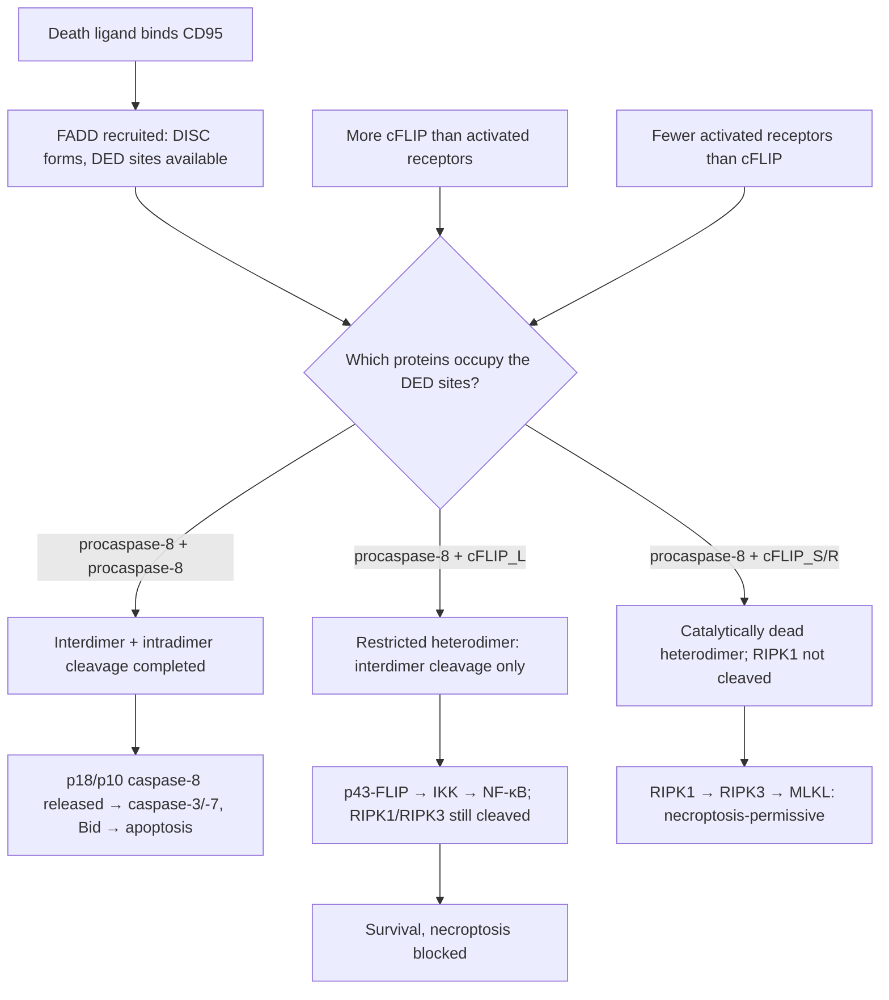

# Procaspase-8 to c-FLIP ratio and c-FLIP_L recruitment kinetics at the CD95 DISC

Scope: a line-by-line investigation of §3.1 of [[_document_ - FLIP the Switch Regulation of Apoptosis and Necroptosis by cFLIP|Tsuchiya et al. 2015]] ("cFLIP Concentration as a Critical Parameter for Cell Fate Determination Revealed by Mathematical Modeling"), focused on the two quantities the passage names: the ratio between procaspase-8 and cFLIP, and the recruitment kinetics of cFLIPL to the [[DISC]]. Sources are the primary modelling and quantitative-experimental papers cited there (Bentele 2004; Lavrik 2007; Fricker 2010; Han 2008; Neumann 2010; Schleich 2012; Kallenberger 2014; Toivonen 2011; Roux 2015) plus the vault notes [[c-FLIP]], [[Caspase-8]], [[Caspase-8-c-FLIP Rheostat]], [[p43-FLIP]], [[DISC]], [[FADD]] and [[Ripoptosome]]. Evidence tiers: Tier 4 = in-vitro cellular or biochemical measurement; Tier 5 = computational model or hypothesis.

## What the passage asserts, and whether the primary literature supports it

| Claim in §3.1 | Primary source | Status |
| --- | --- | --- |
| Endogenous cFLIP concentration is generally low compared with procaspase-8 | Bentele et al. 2004 (parameter estimation); Fricker et al. 2010 (quantitative Western blot) | Supported (Tier 4/5): cFLIPL ≈ 320 molecules per HeLa-CD95 cell; the procaspase-8 pool was not quantified in the same study, but Bentele et al. state their fit requires "many more CD95 receptors and procaspase-8 molecules than c-FLIP molecules" |
| The procaspase-8 : cFLIP ratio is a critical parameter for cell fate | Bentele 2004; Fricker 2010; Neumann 2010 | Supported, but the operative ratio is the competition for DISC binding sites, not the bulk cytosolic ratio (Tier 4/5) |
| cFLIPL concentration determines the threshold ligand concentration | Bentele et al. 2004 | Supported: cFLIP acts by blocking DISC binding sites, so the threshold is set by cFLIP abundance versus the number of activated receptors (Tier 5, with experimental validation of the direction) |
| Sub-threshold CD95L transduces ERK/survival signalling | Lavrik et al. 2007 | Supported (Tier 4): the DISC still forms at low ligand, procaspase-8 activation is blocked by cFLIP recruitment, and ERK/MAPK activation occurs |
| cFLIPL can either accelerate or slow death, dose-dependently in CD95L and cFLIPL | Fricker et al. 2010 | Supported, with the necessary qualifiers: the acceleration requires moderate cFLIPL with strong stimulation, or the presence of abundant cFLIPS/R (Tier 4) |
| cFLIPS and cFLIPR only inhibit procaspase-8 activation | Fricker et al. 2010 | Partly supported: they inhibit procaspase-8 activation, but they also modulate cFLIPL's sensitizing effect, so they are not inert inhibitors (Tier 4) |
| cFLIPL establishes bistability in caspase-8 and caspase-3 activation | Han et al. 2008 | Model prediction only (Tier 5), from a reduced ODE system with no experimental validation in that paper; the switch-like behaviour is consistent with later work (Roux 2015; Toivonen 2011) |
| cFLIPL recruitment kinetics to the DISC and subsequent p43-FLIP generation are the critical parameter | Neumann et al. 2010 | Partly supported: their model makes the cFLIPL level at the DISC (and hence p43-FLIP amplitude and timing) decisive, but the fitted difference is a lower DISC affinity of procaspase-8 relative to cFLIPL, not a separate kinetic term. Superseded in mechanism by Hughes et al. 2016 (hierarchical, procaspase-8-dependent recruitment) and Humphreys et al. 2020 (a stoichiometric conversion point) — Tier 4/5 |
| A subtle balance between cFLIPL and procaspase-8 determines the life/death decision non-linearly | Neumann et al. 2010 | Supported (Tier 5 model + Tier 4 validation): the phase diagram in their reduced model places measured HeLa-CD95 levels centrally, so small changes flip the outcome |
| cFLIP and caspase-8 expression levels vary highly between cell lines, which may explain conflicting published results | Toivonen et al. 2011; Roux et al. 2015 | Supported in mechanism (Tier 5 modelling of cell-to-cell variability). Now quantified at database level: across CCLE cell lines, CFLAR mRNA spans 0.01–76.38 RPKM and CASP8 0.01–44.88, with per-line protein-level c-FLIP:caspase-8 z-score differences from −1.84 to +2.13; neither gene is commonly amplified, so the variability is expression-level, not genomic (Tier 4 database) |

## The ratio is a binding-site competition, not a bulk ratio

The passage names the wrong quantity: the procaspase-8 : cFLIP ratio is not a ratio between two cytosolic pools. In the DISC the relevant competition is for the DED-binding surface of [[FADD]]:

- procaspase-8, procaspase-10 and cFLIP all bind FADD through their tandem death-effector domains. Quantitative mass spectrometry of the native TRAIL DISC found FADD to be sub-stoichiometric, with up to 9-fold more caspase-8 than FADD (Dickens et al. 2012, *Mol Cell* 47:291–305); analysis of the CD95L-induced DISC likewise found the DED proteins to exceed FADD several-fold (Schleich et al. 2012, *Mol Cell* 47:306–319). Both support DED chains rather than a 1:1 stoichiometry.
- Because each cFLIP molecule that occupies a DISC site blocks that site, the threshold is set by the comparison of cFLIP abundance with the number of activated receptors, not with the procaspase-8 pool. Bentele et al. (2004) estimated ≈40 000 CD95 receptors per SKW 6.4 cell and found apoptosis to stop below a ligand:receptor ratio of ≈1:10²; at that ligand level the number of activated receptors (order 10²–10³) is comparable to the cFLIP pool (order 10²), so cFLIP saturates the available DISC sites. Above it, activated receptors outnumber cFLIP, and caspase-8 activation proceeds.
- The consequence is a ligand threshold that rises approximately linearly with total cFLIP concentration in the Bentele model: Toivonen et al. (2011) reproduced that relation and reported a threshold of 7.2 ng/ml for the model's nominal cFLIP level of 0.2937 relative units per isoform.

The operative ratio is therefore local: cFLIP : activated DISC sites. Procaspase-8 enters as the substrate that must pair with itself, in a caspase-8/caspase-8 homodimer. Neumann et al. (2010) make this explicit: in their fitted model, procaspase-8 has a lower affinity for the DISC than cFLIPL, so cFLIPL is recruited preferentially and the remaining sites set how many procaspase-8 homodimers form.

### DED surface selectivity lets a low-abundance cFLIP compete

The affinity advantage that Neumann et al. fitted has a structural basis identified by Majkut et al. (2014, *Nat Commun* 5:3350): FADD's death-effector domain presents two distinct binding surfaces defined by the α1/α4 and α2/α5 helices, and FLIP binds preferentially to the α1/α4 surface whereas procaspase-8 binds preferentially to the α2/α5 surface. Their conclusion is directly relevant to the passage's first sentence: these relative affinities "contribute to FLIP being recruited to the DISC at comparable levels to procaspase 8 despite lower cellular expression". A protein orders of magnitude less abundant therefore occupies a comparable share of the DISC, so the procaspase-8 : cFLIP ratio is not a reflection of the two cytosolic concentrations.

The primary literature disagrees on this point, and the passage does not report the disagreement: quantitative mass spectrometry put the amount of cFLIP in the native DISC as "very low" (Schleich et al. 2012), whereas Majkut et al. (2014) report FLIP recruited at levels comparable to procaspase-8 in a two-step DISC model built on surface-selective affinity, and they also report the ratio of (procaspase-8 + cFLIP) : FADD at DR5-agonist-induced DISCs as at most 2:1, arguing against long DED chains in that system. Cell type, receptor/ligand pairing and stimulus strength are all named as reasons for the divergence (Tier 4).

## cFLIP_L recruitment kinetics to the DISC

Neumann et al. (2010, *Mol Syst Biol* 6:352) quantify DISC recruitment directly and report results that differ from the passage's summary:

- **Preferential recruitment.** Parameter estimation returned a lower DISC affinity for procaspase-8 than for cFLIPL, consistent with Chang et al. (2002) and Lavrik et al. (2007). The consequence is kinetic asymmetry: with increasing stimulus strength the p43/p41 peak arrives earlier, whereas the timing of the p43-FLIP maximum is essentially invariant to stimulus strength — validated experimentally by Western blot in HeLa-CD95 cells stimulated with 1500 vs 500 ng/ml anti-CD95 antibody.
- **Depletion of the cytosolic pool.** Fricker et al. (2010) modelled the corollary: because the total cFLIP pool is so small, strong stimulation recruits essentially all of it to the DISC, so the *relative* cFLIP share of the DISC is higher at weak stimulation than at strong stimulation. The threshold therefore depends on the ratio of cFLIP to activated receptors, not on ligand dose alone.
- **Bell-shaped p43-FLIP response.** In the reduced model, p43-FLIP generation as a function of cFLIPL concentration is bell-shaped: both low and high cFLIPL suppress it, with a steep rise over one order of magnitude around the measured HeLa-CD95 level. At low cFLIPL the model predicts almost no p43-FLIP; the experimental knockdown series (shRNA against cFLIP) reproduced "lower cFLIP → less p43-FLIP but marginally decreased p43/p41", and four HeLa-CD95/cFLIPL clones of graded expression reproduced the rising limb of the predicted curve. The predicted fall-off at very high cFLIPL was not reached experimentally because the clones did not overexpress sufficiently.
- **p43-FLIP is the NF-κB link, and the divergence point is the DISC.** The model postulates that p43-FLIP interacts with the IKK complex; this was validated by co-immunoprecipitation of p43-FLIP with IKKα 30 min after CD95 stimulation in HeLa-CD95 cells, by NF-κB reporter assays (p43-FLIP strong inducer, cFLIPL weak), and by the loss of CD95-induced NF-κB activation with a cleavage-dead cFLIPL(D376E) mutant. With zVAD-fmk blocking apoptosis while leaving DISC cleavage and IκB phosphorylation largely intact, the apoptotic and NF-κB branches diverge at the DISC itself.
- **Phase diagram.** Simulating caspase-3 activity and NF-κB activity as a function of procaspase-8 and cFLIPL levels gives four regions (caspase-3 alone, NF-κB alone, both, neither). The measured HeLa-CD95 levels sit in the central region, so small concentration changes switch scenarios — the model-based reconciliation of the pro- versus anti-apoptotic literature on cFLIPL.

The passage's phrase "cFLIPL recruitment kinetics to the DISC and subsequent generation of p43-FLIP was the critical parameter" holds only if "recruitment kinetics" is read as "the composition and timing of the recruited set at the DISC". Read as a kinetic rate constant it exceeds what Neumann et al. fitted: a binding-affinity ordering and the resulting p43-FLIP time course. Their model was reduced from 92 to 23 reactions (model 8), with 17 fewer free parameters, to keep the estimates identifiable.

## Mechanistic summary: how the ratio changes the outcome

| Species pair at the DISC | Chemistry | Consequence |
| --- | --- | --- |
| procaspase-8 / procaspase-8 | Both interdimer (Asp374/384) and intradimer cleavage completed (Kallenberger et al. 2014: prodomain cleavage intra-dimer within one DISC, enzymatic-domain cleavage inter-dimer between DISCs) | p18/p10 heterotetramer released → caspase-3/-7 and [[Bid]] → [[Apoptosis]] |
| procaspase-8 / cFLIPL | Catalytically restricted heterodimer: performs interdimer cleavage of neighbours, generates p43-FLIP, cannot complete intradimer processing | No executioner signal; p43-FLIP → IKK → [[NF-κB]]; RIPK1/RIPK3 cleavage preserved → survival with [[Necroptosis]] blocked |
| procaspase-8 / cFLIPS/R | Fully inactive heterodimer; cannot cleave RIPK1 | Apoptosis off and RIPK1–RIPK3–[[MLKL]] unopposed → necroptosis-permissive |

The quantitative anchors for these claims:

| Quantity | Value | Source |
| --- | --- | --- |
| CD95 receptors per cell (SKW 6.4) | ≈40 000 | Bentele et al. 2004 (*J Cell Biol* 166:839–851; PMID 15364960) |
| Ligand threshold at the model's nominal cFLIP level | 7.2 ng/ml; threshold ≈ linear in total cFLIP | Toivonen et al. 2011 (*JBC* 286:18375–18382; PMID 21324892) |
| Ligand:receptor ratio at threshold | ≈1:10² | Bentele et al. 2004 |
| cFLIPL molecules per cell (HeLa-CD95) | ≈320 | Fricker et al. 2010 (*J Cell Biol* 190:377–389; PMID 20696707) |
| cFLIP half-lives (K562) | 40 min (cFLIPS/R), 120 min (cFLIPL) | Poukkula et al., via Toivonen et al. 2011 |
| cFLIP lowered by cycloheximide (SKW 6.4) | up to −70%, procaspase-8 unchanged; death then occurs at 1 ng/ml ligand | Bentele et al. 2004 |
| Fractional killing | threshold in rate and timing of initiator caspase activation; cFLIP and Bcl-2 quantified as resistance genes | Roux et al. 2015 (*Mol Syst Biol* 11:803; PMID 25953765) |

## Qualifications the passage needs

1. **"The ratio between procaspase-8 and cFLIP"** — the modelled variables are the cFLIP pool and the number of activated DISC binding sites; procaspase-8 is the substrate that must pair with itself. Restating the claim as "the cFLIP : activated-receptor ratio at the DISC" is closer to the published models.
2. **"cFLIPL could either accelerate or slow down cell death"** — accurate, but the acceleration is conditional: it required moderate cFLIPL with strong receptor stimulation, or the presence of abundant cFLIPS/R (Fricker et al. 2010). In HeLa-CD95 cells, very high cFLIPL overexpression reduced procaspase-8 processing and death, and in HeLa wild-type cells (≈10-fold less CD95) even a 20-fold cFLIPL increase slowed death at 3 µg/ml ligand.
3. **"cFLIPS and cFLIPR only inhibited procaspase-8 activation"** — they also abrogate the cFLIPL-dependent sensitisation, so treating the isoforms as independent pathways is misleading (Fricker et al. 2010).
4. **"cFLIPL established bistability"** — a simulation output from a reduced model without experimental validation in Han et al. (2008); it should be carried as a model prediction (Tier 5), not an established property.
5. **"cFLIPL recruitment kinetics"** — Neumann et al. fitted a binding-affinity ordering and derived p43-FLIP time courses; they did not identify an independent kinetic rate constant as the single "critical parameter", and their p43-FLIP response to cFLIPL level is bell-shaped rather than monotonic.
6. **Cell-line variability** — the claim that differing endogenous expression levels explain conflicting published results is mechanistic and plausible (supported by the phase-diagram analysis and the cell-to-cell variability modelling of Toivonen 2011 and Roux 2015), but no cross-cell-line survey of cFLIP : caspase-8 copy numbers was located; it remains unquantified.
7. **Model identifiability** — Bentele et al. noted their model remained underdetermined (different parameter sets fitting the same data), and Neumann et al. reduced 92 reactions to 23 partly for this reason; quantitative predictions from these models should be presented as model-conditioned.

## Post-2015 evidence that updates or contradicts the passage

The passage was written against 2004–2014 literature. The following verified post-2015 results change how its claims should be stated.

**The recruitment mechanism is not a competition for FADD.** Hughes et al. (2016, *Mol Cell* 61:834–849; PMID 26990987) used a reconstituted functional DISC, structure-guided mutagenesis and label-free LC-MS/MS and found that c-FLIP binding to the DISC is "a co-operative procaspase-8-dependent process": FADD recruits procaspase-8 first, which then recruits and heterodimerizes with c-FLIPL/c-FLIPS. The same study quantified ≈6-fold more caspase-8 than FADD in the native DISC, a 1:1:1 FADD:caspase-8:c-FLIP ratio in c-FLIPS-overexpressing cells, and confirmed the biphasic effect ("low concentrations of c-FLIPL promoting procaspase-8 activation, whereas higher levels of c-FLIPL resulted in concentration-dependent inhibition"). The consequence for the passage: the site-competition picture used here (and by Neumann et al.) is an abstraction, and the literal premise that c-FLIP competes with procaspase-8 for FADD is contradicted by the reconstitution data (Tier 4).

**The pro-/anti-apoptotic switch is a stoichiometry, not a concentration threshold.** Humphreys et al. (2020, *EMBO Rep* 21:e49254; PMID 32009295) revised the DISC assembly model to define "the stoichiometry (with respect to caspase-8) at which [FLIP(L)] converts from being anti- to pro-apoptotic at the DISC", and reported that in the complete absence of FLIP(L) procaspase-8 activation at the TRAIL-R2 DISC is significantly slower even though the final extent of apoptosis is greater. This reframes the ratio question as a threshold in c-FLIP_L : caspase-8 stoichiometry at the DISC (Tier 4).

**Chain composition is measured.** Schleich et al. (2016, *Cell Death Differ* 23:681–694; PMID 26494467) quantified c-FLIP and procaspase-10 in the DED chain as present in about 10-fold lower amounts than procaspase-8, and showed that short c-FLIP isoforms act as chain terminators while the procaspase-8 prodomain — not c-FLIP — provides the negative feedback that terminates chain elongation. Cryo-EM structures then displaced the linear chain picture (Fu et al. 2016, *Mol Cell* 64:236–250: "Extensive assembly interfaces not predicted by the previously proposed linear DED chain model were uncovered"), and cryo-EM showed c-FLIPS blocking caspase-8 by altering the tDED triple-helix architecture rather than by simple occupancy (Fox et al. 2021, *Nat Commun* 12:819) (Tier 4).

**Assembly direction is still being revised.** Yang et al. (2024, *Nat Commun* 15:3791) resolved the ternary FADD–procaspase-8–c-FLIP DED complex in X-ray and cryo-EM structures and proposed a unified DED-assembly mechanism across DISC, complex II and ripoptosome; the same group (2024, *Nat Commun* 15:8974) reported "reverse hierarchical DED assembly" in which c-FLIP and procaspase-8 form a binary tDED complex independent of FADD, which then recruits FADD. The newest high-resolution model (Fosuah et al. 2025, *PNAS* 122:e2504819122) places an asymmetric 7:5 Fas/FADD death-domain oligomer as the nucleation scaffold in cryo-EM reconstructions (Tier 4).

**Receptor-level input to the threshold.** Single-molecule image spectroscopy and STED/FCS measurements (Bartels et al. 2024, *Sci Adv* 10:eadn3238) report that CD95 in the imaged cells is mostly monomeric (~96%) before ligand and that ligand induces dimer/trimer formation (~15%). This supplies the activated-receptor count on which the threshold arithmetic in §"The ratio is a binding-site competition, not a bulk ratio" depends (Tier 4).

**Necroptosis licensing: RIPK1, not RIPK3.** Newton et al. (2019, *Nature* 574:428–431) showed in mice that cleavage of RIPK1 by caspase-8 limits apoptosis and necroptosis; Tran et al. (2024, *Cell Death Differ* 31:662–671) then showed in mice that caspase-8 does not inhibit necroptosis by directly cleaving RIPK3 (Ripk3-D333A mice are viable). The vault's "c-FLIPL heterodimer cleaves RIPK1/RIPK3" phrasing needs the RIPK3 half removed (Tier 3/4).

**The p43-FLIP → NF-κB arm has two routes and a counter-route.** Koenig et al. (2014, *JBC* 289:1183–1191) showed in mouse T cells that p43-FLIP associates with Raf1, TRAF2 and RIPK1 and augments ERK and NF-κB activation — a route distinct from Neumann et al.'s IKK interaction. Davidovich et al. (2023, *Cell Rep* 42:113476) then reported in cultured cells that cFLIPL acts as a *suppressor* of Fas/TRAIL-initiated NF-κB by inhibiting assembly of caspase-8/FADD/RIPK1 "FADDosome" complexes; cFLIP deletion increased inflammatory cytokine output in those cultures. The passage's one-directional "c-FLIPL → NF-κB" framing is therefore context-dependent (Tier 4).

**Cell-line variability, quantified.** Across CCLE cell lines (Broad 2019, cBioPortal): CFLAR mRNA median 4.56 RPKM (IQR 2.96–7.58, range 0.01–76.38; n = 1156) versus CASP8 median 5.71 (IQR 3.41–8.32, range 0.01–44.88); protein-level z-scores give per-line CFLAR − CASP8 differences from −1.84 to +2.13 (n = 36 lines with both measurements); copy number is neutral in the large majority of lines for both genes (CFLAR: 1009 neutral, 9 gain, 12 loss; CASP8: 1008 neutral, 7 gain, 15 loss), so the variability the passage invokes is expression-level, not genomic. Human Protein Atlas classifies both genes as housekeeping-like, detected in all tissues, with low cancer specificity — consistent with the determinant being the protein-level isoform ratio and turnover (Tier 4 database). No absolute molecules-per-cell dataset for procaspase-8 or c-FLIP isoforms was located (PaxDB/ProteomicsDB were unreachable; DepMap was behind a challenge), so the ≈320 c-FLIPL molecules per cell of Fricker et al. (2010) remains the only absolute figure available.

**Model-side updates.** Ivanisenko and Lavrik (2020, *Biochemistry (Moscow)* 85:1134–1144) explicitly optimise "the optimal c-FLIPL to procaspase-8 ratios in different cellular landscapes"; Matveeva et al. (2019, *PLoS Comput Biol* 15:e1007374) show kinetic proofreading producing fractional killing at low receptor stimulation, which is the mechanistic basis for the Roux 2015 threshold; Hillert et al. (2020, *Oncogene* 39:1756–1772) show c-FLIP binding both FADD and procaspase-8 within the DED filament and acting as a bridge between adjacent DISCs (Tier 5 modelling; Tier 4 structural).

**Therapeutic corollary.** The caspase-8/c-FLIPL heterodimer is now a druggable node: FLIPin is the first chemical probe against it (Hillert et al. 2020, *Cell Death Differ* 27:2117–2130), and complex-II-directed variants extend the idea to pancreatic cancer (Hillert-Richter et al. 2024; König et al. 2025). In ENKL cell lines, efficient c-FLIPL recruitment to the DISC after Fas ligation is the reported resistance mechanism (Masuda et al. 2020, *Cancer Sci* 111:807–816) — the closest direct measurement of "c-FLIPL recruitment kinetics to the DISC" at whole-cell level (Tier 4).

**Reviews that supersede the passage.** Ivanisenko et al. (2022, *Trends Cancer* 8:190–209) is the current review with the same scope as Tsuchiya et al. 2015; Humphreys et al. (2018, *FEBS J* 285:4104–4123), Smyth et al. (2020, *FEBS J* 287:4246–4260), Seyrek et al. (2020, *Trends Cell Biol* 30:354–369) and Urbini et al. (2026, *Cell Death Dis* 17:533) cover the therapeutic, pseudo-caspase, post-translational and immunological angles respectively.

**Corrections to the research brief used for this task.** The often-cited "Safa et al. 2018, *Cancer Lett*" cFLIP review does not exist in the indexed literature (nearest: Safa et al. 2019, *Biomarkers J* 5:4); and two CD95 receptor-assembly papers exist only as preprints (Liesche et al. 2018, bioRxiv 293530; Shang et al. 2026, bioRxiv 2026.05.07.723507) and should not be cited as peer-reviewed.

## Companion simulation

Published page: [DISC ratio & recruitment-kinetics explorer](https://graph.johnnykuo.com/pages/en-US/disc-rheostat-sim.html) (zh-TW: [DISC 比例與招募動力學探索器](https://graph.johnnykuo.com/pages/zh-TW/disc-rheostat-sim.html)), repository file `web/public/pages/en-US/disc-rheostat-sim.html` — a self-contained three.js page (importmap to a CDN build of three.js) with sliders for cFLIPL, cFLIPS/R, procaspase-8 and CD95L, a three.js view of DISC recruitment, branch time courses and an outcome phase diagram over cFLIPL × procaspase-8.

It is explicitly an **illustrative model**: its constants are not the published parameter sets, it omits IAPs/XIAP, mitochondrial amplification and cFLIP turnover balance, and its time axis is in arbitrary model units. It reproduces four qualitative results only — the ligand threshold set by cFLIP abundance (Bentele 2004), survival with p43-FLIP/NF-κB signalling below that threshold (Lavrik 2007; Neumann 2010), the blocking behaviour of stoichiometric cFLIP and of cFLIPS/R, and the cFLIPL contribution to the first cleavage step (Fricker 2010). Two known artefacts: at saturating ligand the model becomes procaspase-8-limited, so removing cFLIP does not accelerate death there; and the 1000-fold on-rate advantage for cFLIP over procaspase-8 at FADD, which makes the threshold visible, is not a published measured value. The page is a single self-contained file (no build step, no state beyond the sliders), with every constant it uses listed in the page's own table.

## What would discriminate the remaining ambiguity

- Single-cell measurement of DISC occupancy: cFLIPL, cFLIPS/R and procaspase-8 copy numbers per cell in the same cell type, ideally with isoform-resolved quantitative proteomics, to place a given cell line on the phase diagram rather than inferring it from bulk lysates.
- Direct measurement of DISC stoichiometry under the same stimulation used for death curves (Schleich-type quantitative mass spectrometry at graded ligand), to test whether the DED-chain model or the two-step Majkut model better predicts the ratio that matters.
- Simultaneous measurement of p43/p41, p43-FLIP and cytosolic caspase-8 in single cells with a NES-IETD-mCherry probe (as in Fricker et al. 2010) to separate "cFLIP blocks the site" from "cFLIP delays turnover".
- Time-resolved p43-FLIP generation at graded ligand in cells with graded cFLIPL, to test the predicted bell shape and its invariance of timing with stimulus strength.

## References

- Bentele M, Lavrik I, Ulrich M, et al. Mathematical modeling reveals threshold mechanism in CD95-induced apoptosis. *J Cell Biol*. 2004;166(6):839–851. doi:[10.1083/jcb.200404158](https://doi.org/10.1083/jcb.200404158). PMID: [15364960](https://pubmed.ncbi.nlm.nih.gov/15364960/).
- Lavrik IN, Golks A, Riess D, Bentele M, Eils R, Krammer PH. Analysis of CD95 threshold signaling: triggering of CD95 (FAS/APO-1) at low concentrations primarily results in survival signaling. *J Biol Chem*. 2007;282(19):13664–13671. doi:[10.1074/jbc.M700434200](https://doi.org/10.1074/jbc.M700434200). PMID: [17347143](https://pubmed.ncbi.nlm.nih.gov/17347143/).
- Lavrik IN. Systems biology of death receptor networks: live and let die. *Cell Death Dis*. 2014;5:e1259. doi:[10.1038/cddis.2014.160](https://doi.org/10.1038/cddis.2014.160). PMID: [24874731](https://pubmed.ncbi.nlm.nih.gov/24874731/).
- Fricker N, Beaudouin J, Richter P, Eils R, Krammer PH, Lavrik IN. Model-based dissection of CD95 signaling dynamics reveals both a pro- and antiapoptotic role of c-FLIPL. *J Cell Biol*. 2010;190(3):377–389. doi:[10.1083/jcb.201002060](https://doi.org/10.1083/jcb.201002060). PMID: [20696707](https://pubmed.ncbi.nlm.nih.gov/20696707/).
- Han L, Zhao Y, Jia X. Mathematical modeling identified c-FLIP as an apoptotic switch in death receptor induced apoptosis. *Apoptosis*. 2008;13(10):1198–1204. doi:[10.1007/s10495-008-0252-3](https://doi.org/10.1007/s10495-008-0252-3). PMID: [18726189](https://pubmed.ncbi.nlm.nih.gov/18726189/).
- Neumann L, Pforr C, Beaudouin J, et al. Dynamics within the CD95 death-inducing signaling complex decide life and death of cells. *Mol Syst Biol*. 2010;6:352. doi:[10.1038/msb.2010.6](https://doi.org/10.1038/msb.2010.6). PMID: [20212524](https://pubmed.ncbi.nlm.nih.gov/20212524/).
- Schleich K, Warnken U, Fricker N, et al. Stoichiometry of the CD95 death-inducing signaling complex: experimental and modeling evidence for a death effector domain chain model. *Mol Cell*. 2012;47(2):306–319. doi:[10.1016/j.molcel.2012.05.006](https://doi.org/10.1016/j.molcel.2012.05.006). PMID: [22683265](https://pubmed.ncbi.nlm.nih.gov/22683265/).
- Dickens LS, Boyd RS, Jukes-Jones R, et al. A death effector domain chain DISC model reveals a crucial role for caspase-8 chain assembly in mediating apoptotic cell death. *Mol Cell*. 2012;47(2):291–305. doi:[10.1016/j.molcel.2012.05.004](https://doi.org/10.1016/j.molcel.2012.05.004). PMID: [22683266](https://pubmed.ncbi.nlm.nih.gov/22683266/).
- Majkut J, Sgobba M, Holohan C, et al. Differential affinity of FLIP and procaspase 8 for FADD's DED binding surfaces regulates DISC assembly. *Nat Commun*. 2014;5:3350. doi:[10.1038/ncomms4350](https://doi.org/10.1038/ncomms4350). PMID: [24577104](https://pubmed.ncbi.nlm.nih.gov/24577104/).
- Kallenberger SM, Beaudouin J, Claus J, Fischer C, Sorger PK, Legewie S, Eils R. Intra- and interdimeric caspase-8 self-cleavage controls strength and timing of CD95-induced apoptosis. *Sci Signal*. 2014;7(316):ra23. doi:[10.1126/scisignal.2004738](https://doi.org/10.1126/scisignal.2004738). PMID: [24619646](https://pubmed.ncbi.nlm.nih.gov/24619646/).
- Toivonen HT, Meinander A, Asaoka T, et al. Modeling reveals that dynamic regulation of c-FLIP levels determines cell-to-cell distribution of CD95-mediated apoptosis. *J Biol Chem*. 2011;286(21):18375–18382. doi:[10.1074/jbc.M110.177097](https://doi.org/10.1074/jbc.M110.177097). PMID: [21324892](https://pubmed.ncbi.nlm.nih.gov/21324892/).
- Roux J, Hafner M, Bandara S, Sims JJ, Hudson H, Chai D, Sorger PK. Fractional killing arises from cell-to-cell variability in overcoming a caspase activity threshold. *Mol Syst Biol*. 2015;11(5):803. doi:[10.15252/msb.20145584](https://doi.org/10.15252/msb.20145584). PMID: [25953765](https://pubmed.ncbi.nlm.nih.gov/25953765/).
- Tsuchiya Y, Nakabayashi O, Nakano H. FLIP the Switch: Regulation of Apoptosis and Necroptosis by cFLIP. *Int J Mol Sci*. 2015;16(12):30321–30341. doi:[10.3390/ijms161226232](https://doi.org/10.3390/ijms161226232). PMID: [26694384](https://pubmed.ncbi.nlm.nih.gov/26694384/).

Post-2015 sources used in the update section:

- Hughes MA, Powley IR, Jukes-Jones R, et al. Co-operative and hierarchical binding of c-FLIP and caspase-8: a unified model defines how c-FLIP isoforms differentially control cell fate. *Mol Cell*. 2016;61(5):834–849. doi:[10.1016/j.molcel.2016.02.023](https://doi.org/10.1016/j.molcel.2016.02.023). PMID: [26990987](https://pubmed.ncbi.nlm.nih.gov/26990987/).
- Humphreys LM, Fox JP, Higgins CA, et al. A revised model of TRAIL-R2 DISC assembly explains how FLIP(L) can inhibit or promote apoptosis. *EMBO Rep*. 2020;21(3):e49254. doi:[10.15252/embr.201949254](https://doi.org/10.15252/embr.201949254). PMID: [32009295](https://pubmed.ncbi.nlm.nih.gov/32009295/).
- Schleich K, Buchbinder JH, Pietkiewicz S, et al. Molecular architecture of the DED chains at the DISC: regulation of procaspase-8 activation by short DED proteins c-FLIP and procaspase-8 prodomain. *Cell Death Differ*. 2016;23(4):681–694. doi:[10.1038/cdd.2015.137](https://doi.org/10.1038/cdd.2015.137). PMID: [26494467](https://pubmed.ncbi.nlm.nih.gov/26494467/).
- Fu TM, Li Y, Lu A, et al. Cryo-EM structure of caspase-8 tandem DED filament reveals assembly and regulation mechanisms of the death-inducing signaling complex. *Mol Cell*. 2016;64(2):236–250. doi:[10.1016/j.molcel.2016.09.009](https://doi.org/10.1016/j.molcel.2016.09.009). PMID: [27746017](https://pubmed.ncbi.nlm.nih.gov/27746017/).
- Fox JL, Hughes MA, Meng X, et al. Cryo-EM structural analysis of FADD:caspase-8 complexes defines the catalytic dimer architecture for co-ordinated control of cell fate. *Nat Commun*. 2021;12(1):819. doi:[10.1038/s41467-020-20806-9](https://doi.org/10.1038/s41467-020-20806-9). PMID: [33547302](https://pubmed.ncbi.nlm.nih.gov/33547302/).
- Yang CY, Lien CI, Tseng YC, et al. Deciphering DED assembly mechanisms in FADD-procaspase-8-cFLIP complexes regulating apoptosis. *Nat Commun*. 2024;15(5):3791. doi:[10.1038/s41467-024-47990-2](https://doi.org/10.1038/s41467-024-47990-2). PMID: [38710704](https://pubmed.ncbi.nlm.nih.gov/38710704/).
- Yang CY, Tseng YC, Tu YF, et al. Reverse hierarchical DED assembly in the cFLIP-procaspase-8 and cFLIP-procaspase-8-FADD complexes. *Nat Commun*. 2024;15(11):8974. doi:[10.1038/s41467-024-53306-1](https://doi.org/10.1038/s41467-024-53306-1). PMID: [39419969](https://pubmed.ncbi.nlm.nih.gov/39419969/).
- Fosuah E, Shen Z, Xie J, et al. Assembly and activation of the death-inducing signaling complex. *PNAS*. 2025;122(21):e2504819122. doi:[10.1073/pnas.2504819122](https://doi.org/10.1073/pnas.2504819122). PMID: [40465623](https://pubmed.ncbi.nlm.nih.gov/40465623/).
- Bartels N, van der Voort NTM, Opanasyuk O, et al. Advanced multiparametric image spectroscopy and super-resolution microscopy reveal a minimal model of CD95 signal initiation. *Sci Adv*. 2024;10(29):eadn3238. doi:[10.1126/sciadv.adn3238](https://doi.org/10.1126/sciadv.adn3238). PMID: [39213362](https://pubmed.ncbi.nlm.nih.gov/39213362/).
- Newton K, Wickliffe KE, Dugger DL, et al. Cleavage of RIPK1 by caspase-8 is crucial for limiting apoptosis and necroptosis. *Nature*. 2019;574(7780):428–431. doi:[10.1038/s41586-019-1548-x](https://doi.org/10.1038/s41586-019-1548-x). PMID: [31511692](https://pubmed.ncbi.nlm.nih.gov/31511692/).
- Tran HT, Kratina T, Coutansais A, et al. RIPK3 cleavage is dispensable for necroptosis inhibition but restricts NLRP3 inflammasome activation. *Cell Death Differ*. 2024;31(5):662–671. doi:[10.1038/s41418-024-01281-x](https://doi.org/10.1038/s41418-024-01281-x). PMID: [38514849](https://pubmed.ncbi.nlm.nih.gov/38514849/).
- Koenig A, Buskiewicz IA, Fortner KA, et al. The c-FLIPL cleavage product p43FLIP promotes activation of ERK, NF-κB, and caspase-8 and T cell survival. *JBC*. 2014;289(2):1183–1191. doi:[10.1074/jbc.M113.506428](https://doi.org/10.1074/jbc.M113.506428). PMID: [24275659](https://pubmed.ncbi.nlm.nih.gov/24275659/).
- Davidovich P, Higgins CA, Najda Z, et al. cFLIP_L acts as a suppressor of TRAIL- and Fas-initiated inflammation by inhibiting assembly of caspase-8/FADD/RIPK1 NF-κB-activating complexes. *Cell Rep*. 2023;42(11):113476. doi:[10.1016/j.celrep.2023.113476](https://doi.org/10.1016/j.celrep.2023.113476). PMID: [37988267](https://pubmed.ncbi.nlm.nih.gov/37988267/).
- Ivanisenko NV, Lavrik IN. Mathematical modeling reveals the importance of the DED filament composition in the effects of small molecules targeting caspase-8/c-FLIP_L heterodimer. *Biochemistry (Moscow)*. 2020;85(9):1134–1144. doi:[10.1134/s0006297920100028](https://doi.org/10.1134/s0006297920100028). PMID: [33202199](https://pubmed.ncbi.nlm.nih.gov/33202199/).
- Hillert LK, Ivanisenko NV, Espe J, et al. Long and short isoforms of c-FLIP act as control checkpoints of DED filament assembly. *Oncogene*. 2020;39(10):1756–1772. doi:[10.1038/s41388-019-1100-3](https://doi.org/10.1038/s41388-019-1100-3). PMID: [31740779](https://pubmed.ncbi.nlm.nih.gov/31740779/).
- Hillert LK, Ivanisenko NV, Busse D, et al. Dissecting DISC regulation via pharmacological targeting of caspase-8/c-FLIP_L heterodimer. *Cell Death Differ*. 2020;27(7):2117–2130. doi:[10.1038/s41418-020-0489-0](https://doi.org/10.1038/s41418-020-0489-0). PMID: [31959913](https://pubmed.ncbi.nlm.nih.gov/31959913/).
- Matveeva A, Fichtner M, McAllister K, et al. Heterogeneous responses to low level death receptor activation are explained by random molecular assembly of the caspase-8 activation platform. *PLoS Comput Biol*. 2019;15(9):e1007374. doi:[10.1371/journal.pcbi.1007374](https://doi.org/10.1371/journal.pcbi.1007374). PMID: [31553717](https://pubmed.ncbi.nlm.nih.gov/31553717/).
- Masuda A, Isobe Y, Sugimoto K, et al. Efficient recruitment of c-FLIP_L to the death-inducing signaling complex leads to Fas resistance in natural killer-cell lymphoma. *Cancer Sci*. 2020;111(3):807–816. doi:[10.1111/cas.14296](https://doi.org/10.1111/cas.14296). PMID: [31908105](https://pubmed.ncbi.nlm.nih.gov/31908105/).
- Ivanisenko NV, Seyrek K, Hillert-Richter LK, et al. Regulation of extrinsic apoptotic signaling by c-FLIP: towards targeting cancer networks. *Trends Cancer*. 2022;8(3):190–209. doi:[10.1016/j.trecan.2021.12.002](https://doi.org/10.1016/j.trecan.2021.12.002). PMID: [34973957](https://pubmed.ncbi.nlm.nih.gov/34973957/).
- Database sources: CCLE (Broad, 2019) RNA-seq, copy-number and protein quantification via the cBioPortal REST API; Human Protein Atlas JSON API (ENSG00000003402, ENSG00000064012).

## Related vault entries

- [[Caspase-8-c-FLIP Rheostat]] — the vault's node for this switch; this task output supplies the quantitative anchors it lacked.
- [[c-FLIP]], [[Caspase-8]], [[DISC]], [[FADD]], [[p43-FLIP]] — molecular participants.
- [[Apoptosis]], [[Necroptosis]], [[NF-κB]], [[ERK]], [[Cell Survival]] — outputs of the two branches.
- [[Ripoptosome]] — the receptor-independent platform where the same rheostat operates.
