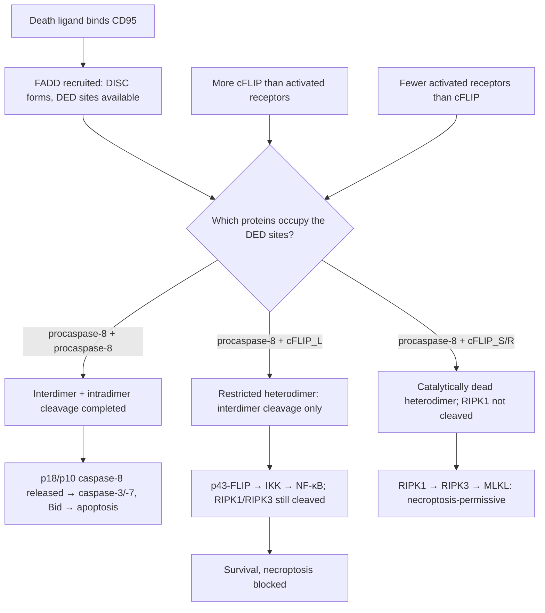

# CD95 DISC 上的 procaspase-8 與 c-FLIP 比例及 c-FLIP_L 招募動力學

範圍：逐行調查 [[_document_ - FLIP the Switch Regulation of Apoptosis and Necroptosis by cFLIP|Tsuchiya et al. 2015]] 的 §3.1（"cFLIP Concentration as a Critical Parameter for Cell Fate Determination Revealed by Mathematical Modeling"），聚焦於該段落指名的兩個量：procaspase-8 與 cFLIP 之間的比例，以及 cFLIPL 對 [[DISC]] 的招募動力學。來源為該處引用的主要建模與定量實驗論文（Bentele 2004; Lavrik 2007; Fricker 2010; Han 2008; Neumann 2010; Schleich 2012; Kallenberger 2014; Toivonen 2011; Roux 2015），加上知識庫筆記 [[c-FLIP]]、[[Caspase-8]]、[[Caspase-8-c-FLIP Rheostat]]、[[p43-FLIP]]、[[DISC]]、[[FADD]] 與 [[Ripoptosome]]。證據層級：Tier 4 = 體外細胞或生化測量；Tier 5 = 計算模型或假說。

## 該段落的主張，以及原始文獻是否支持

| §3.1 中的主張 | 原始來源 | 狀態 |
| --- | --- | --- |
| 內源性 cFLIP 濃度相對於 procaspase-8 一般偏低 | Bentele et al. 2004（參數估計）；Fricker et al. 2010（定量 Western blot） | 獲得支持（Tier 4/5）：cFLIPL ≈ 每個 HeLa-CD95 細胞 320 個分子；procaspase-8 儲備量並未在同研究中量化，但 Bentele et al. 表示其擬合需要 "many more CD95 receptors and procaspase-8 molecules than c-FLIP molecules" |
| procaspase-8 : cFLIP 比例是細胞命運的關鍵參數 | Bentele 2004; Fricker 2010; Neumann 2010 | 獲得支持，但真正起作用的比例是對 DISC 結合位點的競爭，而非整體細胞質中的比例（Tier 4/5） |
| cFLIPL 濃度決定閾值配體濃度 | Bentele et al. 2004 | 獲得支持：cFLIP 的作用方式是封阻 DISC 結合位點，因此閾值由 cFLIP 豐度與活化受體數目的相對關係決定（Tier 5，並有實驗支持其方向） |
| 閾值以下的 CD95L 傳遞 ERK／存活訊號 | Lavrik et al. 2007 | 獲得支持（Tier 4）：低配體下 DISC 仍可形成，procaspase-8 的活化被 cFLIP 招募阻斷，且出現 ERK/MAPK 活化 |
| cFLIPL 在 CD95L 與 cFLIPL 條件下可依劑量加速或減緩死亡 | Fricker et al. 2010 | 獲得支持，但需必要的限定：加速需要中等量的 cFLIPL 搭配強刺激，或存在大量 cFLIPS/R（Tier 4） |
| cFLIPS 與 cFLIPR 僅抑制 procaspase-8 的活化 | Fricker et al. 2010 | 部分獲得支持：它們確實抑制 procaspase-8 的活化，但也會調節 cFLIPL 的致敏作用，因此並非惰性抑制者（Tier 4） |
| cFLIPL 在 caspase-8 與 caspase-3 活化中建立雙穩定性 | Han et al. 2008 | 僅為模型預測（Tier 5），來自一個簡化 ODE 系統且該論文未提供實驗驗證；此類開關式行為與後續工作一致（Roux 2015; Toivonen 2011） |
| cFLIPL 對 DISC 的招募動力學及其後續 p43-FLIP 的產生是關鍵參數 | Neumann et al. 2010 | 部分獲得支持：其模型使 DISC 上的 cFLIPL 濃度（因而使 p43-FLIP 的振幅與時序）具有決定性，但所擬合的差異是 procaspase-8 相對於 cFLIPL 較低的 DISC 親和力，而非一個獨立的動力學項。在機制上已被 Hughes et al. 2016（階層式、procaspase-8 依賴的招募）與 Humphreys et al. 2020（一個化學計量轉換點）取代——Tier 4/5 |
| cFLIPL 與 procaspase-8 之間的微妙平衡以非線性方式決定生死決策 | Neumann et al. 2010 | 獲得支持（Tier 5 模型 + Tier 4 驗證）：其簡化模型中的相圖將實測的 HeLa-CD95 濃度置於中央，因此小幅變動即可翻轉結果 |
| cFLIP 與 caspase-8 的表達量在不同細胞株間高度變異，可能解釋已發表結果之間的矛盾 | Toivonen et al. 2011; Roux et al. 2015 | 在機制上獲得支持（Tier 5 對細胞間變異性的建模）。現已在資料庫層面量化：在 CCLE 細胞株中，CFLAR mRNA 跨 0.01–76.38 RPKM，CASP8 為 0.01–44.88，各株蛋白層級的 c-FLIP:caspase-8 z 分數差異從 −1.84 到 +2.13；兩個基因通常都沒有擴增，因此此變異性屬表達層級而非基因組層級（Tier 4 資料庫） |

## 此比例是結合位點的競爭，而非整體比例

該段落指名的量是錯的：procaspase-8 : cFLIP 比例不是兩個細胞質儲備池之間的比例。在 DISC 中，相關的競爭是對 [[FADD]] 的 DED 結合面的競爭：

- procaspase-8、procaspase-10 與 cFLIP 都透過其串聯死亡效應域與 FADD 結合。對原生 TRAIL DISC 的定量質譜分析發現 FADD 為次化學計量，caspase-8 最多可比 FADD 多 9 倍（Dickens et al. 2012, *Mol Cell* 47:291–305）；對 CD95L 誘導之 DISC 的分析同樣發現 DED 蛋白數量比 FADD 多數倍（Schleich et al. 2012, *Mol Cell* 47:306–319）。兩者皆支持 DED 鏈，而非 1:1 的化學計量。
- 由於每個佔據 DISC 位點的 cFLIP 分子都會封阻該位點，閾值由 cFLIP 豐度與活化受體數目的比較決定，而非與 procaspase-8 儲備池比較。Bentele et al.（2004）估計每個 SKW 6.4 細胞約有 40 000 個 CD95 受體，並發現當配體:受體比例低於 ≈1:10² 時凋亡停止；在該配體水準下，活化受體的數目（10²–10³ 數量級）與 cFLIP 儲備池（10² 數量級）相當，因此 cFLIP 使可用的 DISC 位點飽和。在其之上，活化受體數多於 cFLIP，caspase-8 的活化便得以進行。
- 其結果是在 Bentele 模型中，閾值配體濃度約略隨總 cFLIP 濃度呈線性上升：Toivonen et al.（2011）重現了該關係，並報告模型標稱 cFLIP 水準（每個亞型 0.2937 相對單位）下閾值為 7.2 ng/ml。

因此，起作用的比例是局部的：cFLIP : 活化的 DISC 位點。procaspase-8 的角色是必須與自身配對的受質，形成 caspase-8/caspase-8 同二聚體。Neumann et al.（2010）明確指出：在其擬合模型中，procaspase-8 對 DISC 的親和力低於 cFLIPL，因此 cFLIPL 會被優先招募，而剩餘的位點決定形成多少 procaspase-8 同二聚體。

### DED 面的選擇性使低豐度的 cFLIP 得以競爭

Neumann et al. 所擬合的親和力優勢，具有 Majkut et al.（2014, *Nat Commun* 5:3350）所辨識的結構基礎：FADD 的死亡效應域呈現兩個由 α1/α4 與 α2/α5 螺旋定義的不同結合面，FLIP 偏好結合 α1/α4 面，而 procaspase-8 偏好結合 α2/α5 面。他們的結論與該段落的第一句直接相關：這些相對親和力 "contribute to FLIP being recruited to the DISC at comparable levels to procaspase 8 despite lower cellular expression"。因此，一個豐度低了數個數量級的蛋白佔據了相當份額的 DISC，故 procaspase-8 : cFLIP 比例並非兩個細胞質濃度的反映。

原始文獻在此點上意見分歧，而該段落並未指出此分歧：定量質譜將原生 DISC 中的 cFLIP 含量測為 "very low"（Schleich et al. 2012），而 Majkut et al.（2014）在一個建立在表面選擇性親和力之上的兩步驟 DISC 模型中報告 FLIP 的招募量與 procaspase-8 相當，並報告在 DR5 激動劑誘導的 DISC 中 (procaspase-8 + cFLIP) : FADD 的比例最多為 2:1，反對該系統中存在長 DED 鏈。細胞類型、受體／配體配對與刺激強度皆被列為分歧的原因（Tier 4）。

## cFLIP_L 對 DISC 的招募動力學

Neumann et al.（2010, *Mol Syst Biol* 6:352）直接量化 DISC 招募，並報告了與該段落摘要不同的結果：

- **優先招募。** 參數估計得出的 procaspase-8 對 DISC 親和力低於 cFLIPL，與 Chang et al.（2002）及 Lavrik et al.（2007）一致。其後果是動力學上的不對稱：隨刺激強度增加，p43/p41 峰提早出現，而 p43-FLIP 最大值的時序基本上不受刺激強度影響——此點已由以 1500 對 500 ng/ml 抗 CD95 抗體刺激的 HeLa-CD95 細胞之 Western blot 實驗驗證。
- **細胞質儲備池的耗竭。** Fricker et al.（2010）對此推論建模：由於總 cFLIP 儲備池極小，強刺激會基本上將其中全部招募至 DISC，因此 DISC 中 cFLIP 的*相對*份額在弱刺激下高於強刺激。閾值因此取決於 cFLIP 與活化受體的比例，而非單靠配體劑量。
- **鐘形的 p43-FLIP 反應。** 在簡化模型中，p43-FLIP 的產生作為 cFLIPL 濃度的函數呈鐘形：過低與過高的 cFLIPL 都會抑制它，在實測 HeLa-CD95 水準附近的一個數量級範圍內則陡升。在低 cFLIPL 下，模型預測幾乎不產生 p43-FLIP；實驗的敲低系列（針對 cFLIP 的 shRNA）重現了 "lower cFLIP → less p43-FLIP but marginally decreased p43/p41"，而四個表達量分級的 HeLa-CD95/cFLIPL 細胞株重現了預測曲線的上升支。在極高 cFLIPL 下預測的下降支未能在實驗中達到，因為這些細胞株的過度表現程度不足。
- **p43-FLIP 是 NF-κB 的連結點，而分歧點在 DISC。** 模型假設 p43-FLIP 與 IKK 複合體相互作用；此點已由 CD95 刺激 HeLa-CD95 細胞 30 min 後 p43-FLIP 與 IKKα 的共免疫沉澱、NF-κB 報導基因試驗（p43-FLIP 為強誘導者，cFLIPL 為弱誘導者），以及使用切割失活的 cFLIPL(D376E) 突變體時 CD95 誘導之 NF-κB 活化喪失所驗證。當 zVAD-fmk 阻斷細胞凋亡而大致保留 DISC 切割與 IκB 磷酸化時，凋亡與 NF-κB 兩支在 DISC 本身即產生分歧。
- **相圖。** 將 caspase-3 活性與 NF-κB 活性視為 procaspase-8 與 cFLIPL 水準的函數進行模擬，得到四個區域（僅 caspase-3、僅 NF-κB、兩者皆有、皆無）。實測的 HeLa-CD95 水準落在中央區域，因此小幅濃度變動即可切換情境——這是模型層次對 cFLIPL 促細胞凋亡與抗細胞凋亡文獻歧異的調和。

該段落的表述 "cFLIPL recruitment kinetics to the DISC and subsequent generation of p43-FLIP was the critical parameter" 只有在把 "recruitment kinetics" 讀作「DISC 上被招募集合的組成與時序」時才成立。若讀作動力學速率常數，則超出了 Neumann et al. 所擬合的範圍：一個結合親和力的排序，以及由此產生的 p43-FLIP 時間歷程。他們的模型由 92 個反應簡化為 23 個（模型 8），並減少 17 個自由參數，以保持估計的可辨識性。

## 機制摘要：此比例如何改變結果

| DISC 上的蛋白配對 | 化學 | 後果 |
| --- | --- | --- |
| procaspase-8 / procaspase-8 | 二聚體間（Asp374/384）與二聚體內切割皆完成（Kallenberger et al. 2014：前驅物域的切割發生於單一 DISC 內的二聚體之間，酵素域的切割發生於 DISC 之間的二聚體之間） | 釋出 p18/p10 異四聚體 → caspase-3/-7 與 [[Bid]] → [[Apoptosis]] |
| procaspase-8 / cFLIPL | 催化活性受限的異二聚體：對鄰近分子執行二聚體間切割，產生 p43-FLIP，無法完成二聚體內加工 | 無執行者訊號；p43-FLIP → IKK → [[NF-κB]]；RIPK1/RIPK3 切割保留 → 存活且 [[Necroptosis]] 受阻 |
| procaspase-8 / cFLIPS/R | 完全無活性的異二聚體；無法切割 RIPK1 | 細胞凋亡關閉且 RIPK1–RIPK3–[[MLKL]] 無對抗 → 允許壞死性凋亡 |

支撐這些主張的定量錨點：

| 量 | 值 | 來源 |
| --- | --- | --- |
| 每個細胞的 CD95 受體數（SKW 6.4） | ≈40 000 | Bentele et al. 2004（*J Cell Biol* 166:839–851; PMID 15364960） |
| 模型標稱 cFLIP 水準下的配體閾值 | 7.2 ng/ml；閾值 ≈ 與總 cFLIP 成線性 | Toivonen et al. 2011（*JBC* 286:18375–18382; PMID 21324892） |
| 閾值處的配體:受體比例 | ≈1:10² | Bentele et al. 2004 |
| 每個細胞的 cFLIPL 分子數（HeLa-CD95） | ≈320 | Fricker et al. 2010（*J Cell Biol* 190:377–389; PMID 20696707） |
| cFLIP 半衰期（K562） | 40 min（cFLIPS/R）、120 min（cFLIPL） | Poukkula et al.，引自 Toivonen et al. 2011 |
| 以環己醯胺降低的 cFLIP（SKW 6.4） | 最多 −70%，procaspase-8 不變；此時死亡在 1 ng/ml 配體下發生 | Bentele et al. 2004 |
| 分級殺傷 | 起始 caspase 活化的速率與時序中的閾值；cFLIP 與 Bcl-2 被量化為抗性基因 | Roux et al. 2015（*Mol Syst Biol* 11:803; PMID 25953765） |

## 該段落所需的限定條件

1. **"The ratio between procaspase-8 and cFLIP"** — 被建模的變數是 cFLIP 儲備池與活化 DISC 結合位點的數目；procaspase-8 是必須與自身配對的受質。將該主張改述為「DISC 上的 cFLIP : 活化受體比例」更接近已發表的模型。
2. **"cFLIPL could either accelerate or slow down cell death"** — 準確，但加速是有條件的：它需要中等量的 cFLIPL 搭配強烈的受體刺激，或存在大量 cFLIPS/R（Fricker et al. 2010）。在 HeLa-CD95 細胞中，極高量的 cFLIPL 過度表現會減少 procaspase-8 的加工與死亡；而在 HeLa 野生型細胞（CD95 少約 10 倍）中，即使 cFLIPL 增加 20 倍，在 3 µg/ml 配體下仍會減緩死亡。
3. **"cFLIPS and cFLIPR only inhibited procaspase-8 activation"** — 它們也會消除 cFLIPL 依賴的致敏作用，因此把各亞型視為彼此獨立的路徑會造成誤導（Fricker et al. 2010）。
4. **"cFLIPL established bistability"** — 這是簡化模型在 Han et al.（2008）中未經實驗驗證的模擬輸出；應以模型預測（Tier 5）呈現，而非既成特性。
5. **"cFLIPL recruitment kinetics"** — Neumann et al. 擬合的是一個結合親和力的排序，並據以導出 p43-FLIP 的時間歷程；他們並未鑑定出一個獨立的動力學速率常數作為唯一的「關鍵參數」，而且其 p43-FLIP 對 cFLIPL 水準的反應是鐘形而非單調。
6. **細胞株間的變異性** — 「內源性表達量差異可解釋已發表結果之間矛盾」的主張在機制上且合理（由 Toivonen 2011 與 Roux 2015 的相圖分析與細胞間變異性建模支持），但並未找到跨細胞株的 cFLIP : caspase-8 拷貝數普查；此數量仍未量化。
7. **模型可辨識性** — Bentele et al. 指出其模型仍為欠定（不同參數組合可擬合相同資料），而 Neumann et al. 將 92 個反應減為 23 個，部分理由即為此；這些模型的定量預測應以模型為條件來呈現。

## 2015 年之後更新或牴觸該段落的證據

該段落是針對 2004–2014 年的文獻寫成的。以下經查證的 2015 年後結果改變了它的主張應如何陳述。

**招募機制並非對 FADD 的競爭。** Hughes et al.（2016, *Mol Cell* 61:834–849; PMID 26990987）使用重組的功能性 DISC、結構引導的突變與無標記 LC-MS/MS，發現 c-FLIP 與 DISC 的結合是 "a co-operative procaspase-8-dependent process"：FADD 先招募 procaspase-8，後者再招募並與 c-FLIPL/c-FLIPS 形成異二聚體。同一研究量化出原生 DISC 中 caspase-8 比 FADD 多約 6 倍、在 c-FLIPS 過度表現的細胞中 FADD:caspase-8:c-FLIP 比例為 1:1:1，並確認了雙相效應（"low concentrations of c-FLIPL promoting procaspase-8 activation, whereas higher levels of c-FLIPL resulted in concentration-dependent inhibition"）。對該段落的後果：此處（以及 Neumann et al.）使用的位點競爭圖像是一種抽象化，而「c-FLIP 與 procaspase-8 競爭 FADD」這個字面前提與重組實驗資料相牴觸（Tier 4）。

**促／抗細胞凋亡的開關是化學計量，而非濃度閾值。** Humphreys et al.（2020, *EMBO Rep* 21:e49254; PMID 32009295）修訂了 DISC 組裝模型，定義「[FLIP(L)] 在 DISC 上由抗細胞凋亡轉為促細胞凋亡的（以 caspase-8 為基準的）化學計量」，並報告在完全缺乏 FLIP(L) 的情況下，TRAIL-R2 DISC 上的 procaspase-8 活化顯著較慢，儘管細胞凋亡的最終程度反而較大。這把比例問題重新框定為 DISC 上 c-FLIP_L : caspase-8 化學計量中的一個閾值（Tier 4）。

**鏈的組成已被測量。** Schleich et al.（2016, *Cell Death Differ* 23:681–694; PMID 26494467）量化出 DED 鏈中的 c-FLIP 與 procaspase-10 存在的量約比 procaspase-8 低 10 倍，並顯示短的 c-FLIP 亞型充當鏈終止子，而提供終止鏈延伸之負回饋的是 procaspase-8 的前驅物域而非 c-FLIP。其後的冷卻電子顯微鏡結構取代了線性鏈的圖像（Fu et al. 2016, *Mol Cell* 64:236–250："Extensive assembly interfaces not predicted by the previously proposed linear DED chain model were uncovered"），而冷卻電子顯微鏡顯示 c-FLIPS 是藉由改變 tDED 三股螺旋架構而非單純佔位來封阻 caspase-8（Fox et al. 2021, *Nat Commun* 12:819）（Tier 4）。

**組裝方向仍在修訂。** Yang et al.（2024, *Nat Commun* 15:3791）以 X 光與冷卻電子顯微鏡結構解析了三元的 FADD–procaspase-8–c-FLIP DED 複合體，並提出橫跨 DISC、complex II 與 ripoptosome 的統一 DED 組裝機制；同一團隊（2024, *Nat Commun* 15:8974）報告了「反向階層式 DED 組裝」，其中 c-FLIP 與 procaspase-8 形成不依賴 FADD 的二元 tDED 複合體，再由其招募 FADD。最新之高解析度模型（Fosuah et al. 2025, *PNAS* 122:e2504819122）在冷卻電子顯微鏡重建中將不對稱的 7:5 Fas/FADD 死亡域寡聚體置於成核支架的位置（Tier 4）。

**受體層級的輸入決定閾值。** 單分子影像光譜與 STED/FCS 量測（Bartels et al. 2024, *Sci Adv* 10:eadn3238）報告，在受測細胞中 CD95 在配體結合前主要為單體（~96%），配體則誘導二聚／三聚體形成（~15%）。這提供了「The ratio is a binding-site competition, not a bulk ratio」一節之閾值運算所依賴的活化受體計數（Tier 4）。

**壞死性凋亡的許可：RIPK1 而非 RIPK3。** Newton et al.（2019, *Nature* 574:428–431）在小鼠中顯示 caspase-8 對 RIPK1 的切割可限制細胞凋亡與壞死性凋亡；Tran et al.（2024, *Cell Death Differ* 31:662–671）隨後在小鼠中顯示 caspase-8 並非藉由直接切割 RIPK3 來抑制壞死性凋亡（Ripk3-D333A 小鼠可存活）。知識庫中「c-FLIPL 異二聚體切割 RIPK1/RIPK3」的表述需要移除 RIPK3 那一半（Tier 3/4）。

**p43-FLIP → NF-κB 這一支有兩條路徑與一條反向路徑。** Koenig et al.（2014, *JBC* 289:1183–1191）在小鼠 T 細胞中顯示 p43-FLIP 與 Raf1、TRAF2 及 RIPK1 結合，並增強 ERK 與 NF-κB 的活化——此為一條不同於 Neumann et al. 之 IKK 相互作用的路徑。Davidovich et al.（2023, *Cell Rep* 42:113476）其後在培養細胞中報告 cFLIPL 藉由抑制 caspase-8/FADD/RIPK1「FADDosome」複合體的組裝，作為 Fas／TRAIL 起始之 NF-κB 的*抑制者*；在那些培養物中，cFLIP 剔除會增加發炎性細胞激素的輸出。因此該段落單向的「c-FLIPL → NF-κB」框定是情境依賴的（Tier 4）。

**細胞株間變異性，已量化。** 在 CCLE 細胞株中（Broad 2019，cBioPortal）：CFLAR mRNA 中位數 4.56 RPKM（IQR 2.96–7.58，範圍 0.01–76.38；n = 1156），相較之下 CASP8 中位數 5.71（IQR 3.41–8.32，範圍 0.01–44.88）；蛋白層級的 z 分數給出各株 CFLAR − CASP8 的差異從 −1.84 到 +2.13（n = 36 條同時具有兩項測量的細胞株）；在絕大多數細胞株中，兩個基因的拷貝數皆為中性（CFLAR：1009 中性、9 增益、12 缺失；CASP8：1008 中性、7 增益、15 缺失），因此該段落所援引的變異性屬表達層級而非基因組層級。Human Protein Atlas 將兩個基因皆分類為類管家基因，在所有組織中皆可偵測，癌症專一性低——與決定因子在於蛋白層級的亞型比例與周轉速率一致（Tier 4 資料庫）。並未找到 procaspase-8 或 c-FLIP 亞型的每細胞絕對分子數資料集（PaxDB／ProteomicsDB 無法連線；DepMap 需通過驗證），因此 Fricker et al.（2010）每細胞 ≈320 個 cFLIPL 分子仍是唯一可用的絕對數值。

**模型層面的更新。** Ivanisenko and Lavrik（2020, *Biochemistry (Moscow)* 85:1134–1144）明確最佳化「the optimal c-FLIPL to procaspase-8 ratios in different cellular landscapes」；Matveeva et al.（2019, *PLoS Comput Biol* 15:e1007374）顯示動力學校對可在低受體刺激下產生分級殺傷，這是 Roux 2015 閾值的機制基礎；Hillert et al.（2020, *Oncogene* 39:1756–1772）顯示 c-FLIP 在 DED 絲狀體中同時結合 FADD 與 procaspase-8，並作為相鄰 DISC 之間的橋接（Tier 5 建模；Tier 4 結構）。

**治療上的推論。** caspase-8/c-FLIPL 異二聚體如今是可成藥的節點：FLIPin 是針對它的第一個化學探針（Hillert et al. 2020, *Cell Death Differ* 27:2117–2130），而以 complex II 為標的的變體將此概念延伸至胰臟癌（Hillert-Richter et al. 2024; König et al. 2025）。在 ENKL 細胞株中，Fas 配結後 c-FLIPL 有效招募至 DISC 即為所報告的抗性機制（Masuda et al. 2020, *Cancer Sci* 111:807–816）——這是在整細胞層次對「c-FLIPL recruitment kinetics to the DISC」最接近的直接量測（Tier 4）。

**取代該段落的綜述。** Ivanisenko et al.（2022, *Trends Cancer* 8:190–209）是目前與 Tsuchiya et al. 2015 範圍相同的綜述；Humphreys et al.（2018, *FEBS J* 285:4104–4123）、Smyth et al.（2020, *FEBS J* 287:4246–4260）、Seyrek et al.（2020, *Trends Cell Biol* 30:354–369）與 Urbini et al.（2026, *Cell Death Dis* 17:533）分別涵蓋治療、偽 caspase、轉譯後與免疫學等角度。

**對本任務所用研究摘要的更正。** 常被引用的「Safa et al. 2018, *Cancer Lett*」cFLIP 綜述在索引文獻中並不存在（最接近者為 Safa et al. 2019, *Biomarkers J* 5:4）；另有兩篇 CD95 受體組裝論文僅以預印本形式存在（Liesche et al. 2018, bioRxiv 293530; Shang et al. 2026, bioRxiv 2026.05.07.723507），不應作為同儕審查文獻引用。

## 配套模擬

已發布頁面：[DISC 比例與招募動力學探索器](https://graph.johnnykuo.com/pages/zh-TW/disc-rheostat-sim.html)（en-US：[DISC ratio & recruitment-kinetics explorer](https://graph.johnnykuo.com/pages/en-US/disc-rheostat-sim.html)），儲存庫檔案 `web/public/pages/en-US/disc-rheostat-sim.html`——一個自足的三頁式 three.js 頁面（以 importmap 引入 three.js 的 CDN 版本），含 cFLIPL、cFLIPS/R、procaspase-8 與 CD95L 的滑桿、一個 DISC 招募的 three.js 檢視、分支時間歷程，以及 cFLIPL × procaspase-8 的結果相圖。

它明確是一個**示意性模型**：其常數並非已發表的參數組合，省略 IAP／XIAP、粒線體放大作用與 cFLIP 周轉平衡，且其時間軸以任意模型單位表示。它只重現四項定性結果——由 cFLIP 豐度設定的配體閾值（Bentele 2004）、在該閾值以下伴隨 p43-FLIP／NF-κB 訊號的存活（Lavrik 2007; Neumann 2010）、化學計量 cFLIP 與 cFLIPS/R 的封阻行為，以及 cFLIPL 對第一步切割的貢獻（Fricker 2010）。有兩項已知的假象：在飽和配體下模型變成 procaspase-8 受限，因此移除 cFLIP 在該條件下不會加速死亡；以及 cFLIP 在 FADD 處相對 procaspase-8 的 1000 倍結合速率優勢（使閾值可見）並非已發表的實測值。該頁面是單一自足檔案（無建置步驟、除滑桿外無狀態），其使用的每個常數都列於頁面自身的表格中。

## 何者可辨別剩餘的歧義

- 以單細胞方式量測 DISC 佔位：同一細胞型中每細胞的 cFLIPL、cFLIPS/R 與 procaspase-8 拷貝數，理想情況下採用可分辨亞型的定量蛋白質組學，以將特定細胞株置於相圖上，而非由整體裂解液推得。
- 在與死亡曲線相同的刺激條件下直接量測 DISC 化學計量（Schleich 式定量質譜，配合分級配體），以檢驗 DED 鏈模型或兩步驟 Majkut 模型何者更能預測關鍵比例。
- 以 NES-IETD-mCherry 探針在單細胞中同時量測 p43/p41、p43-FLIP 與細胞質 caspase-8（如 Fricker et al. 2010 所做），以區分「cFLIP 封阻位點」與「cFLIP 延遲周轉」。
- 在 cFLIPL 表達量分級的細胞中，以分級配體量測 p43-FLIP 生成的時間解析歷程，以檢驗預測的鐘形及其時序對刺激強度的恆定性。

## 參考文獻

- Bentele M, Lavrik I, Ulrich M, et al. Mathematical modeling reveals threshold mechanism in CD95-induced apoptosis. *J Cell Biol*. 2004;166(6):839–851. doi:[10.1083/jcb.200404158](https://doi.org/10.1083/jcb.200404158). PMID: [15364960](https://pubmed.ncbi.nlm.nih.gov/15364960/).
- Lavrik IN, Golks A, Riess D, Bentele M, Eils R, Krammer PH. Analysis of CD95 threshold signaling: triggering of CD95 (FAS/APO-1) at low concentrations primarily results in survival signaling. *J Biol Chem*. 2007;282(19):13664–13671. doi:[10.1074/jbc.M700434200](https://doi.org/10.1074/jbc.M700434200). PMID: [17347143](https://pubmed.ncbi.nlm.nih.gov/17347143/).
- Lavrik IN. Systems biology of death receptor networks: live and let die. *Cell Death Dis*. 2014;5:e1259. doi:[10.1038/cddis.2014.160](https://doi.org/10.1038/cddis.2014.160). PMID: [24874731](https://pubmed.ncbi.nlm.nih.gov/24874731/).
- Fricker N, Beaudouin J, Richter P, Eils R, Krammer PH, Lavrik IN. Model-based dissection of CD95 signaling dynamics reveals both a pro- and antiapoptotic role of c-FLIPL. *J Cell Biol*. 2010;190(3):377–389. doi:[10.1083/jcb.201002060](https://doi.org/10.1083/jcb.201002060). PMID: [20696707](https://pubmed.ncbi.nlm.nih.gov/20696707/).
- Han L, Zhao Y, Jia X. Mathematical modeling identified c-FLIP as an apoptotic switch in death receptor induced apoptosis. *Apoptosis*. 2008;13(10):1198–1204. doi:[10.1007/s10495-008-0252-3](https://doi.org/10.1007/s10495-008-0252-3). PMID: [18726189](https://pubmed.ncbi.nlm.nih.gov/18726189/).
- Neumann L, Pforr C, Beaudouin J, et al. Dynamics within the CD95 death-inducing signaling complex decide life and death of cells. *Mol Syst Biol*. 2010;6:352. doi:[10.1038/msb.2010.6](https://doi.org/10.1038/msb.2010.6). PMID: [20212524](https://pubmed.ncbi.nlm.nih.gov/20212524/).
- Schleich K, Warnken U, Fricker N, et al. Stoichiometry of the CD95 death-inducing signaling complex: experimental and modeling evidence for a death effector domain chain model. *Mol Cell*. 2012;47(2):306–319. doi:[10.1016/j.molcel.2012.05.006](https://doi.org/10.1016/j.molcel.2012.05.006). PMID: [22683265](https://pubmed.ncbi.nlm.nih.gov/22683265/).
- Dickens LS, Boyd RS, Jukes-Jones R, et al. A death effector domain chain DISC model reveals a crucial role for caspase-8 chain assembly in mediating apoptotic cell death. *Mol Cell*. 2012;47(2):291–305. doi:[10.1016/j.molcel.2012.05.004](https://doi.org/10.1016/j.molcel.2012.05.004). PMID: [22683266](https://pubmed.ncbi.nlm.nih.gov/22683266/).
- Majkut J, Sgobba M, Holohan C, et al. Differential affinity of FLIP and procaspase 8 for FADD's DED binding surfaces regulates DISC assembly. *Nat Commun*. 2014;5:3350. doi:[10.1038/ncomms4350](https://doi.org/10.1038/ncomms4350). PMID: [24577104](https://pubmed.ncbi.nlm.nih.gov/24577104/).
- Kallenberger SM, Beaudouin J, Claus J, Fischer C, Sorger PK, Legewie S, Eils R. Intra- and interdimeric caspase-8 self-cleavage controls strength and timing of CD95-induced apoptosis. *Sci Signal*. 2014;7(316):ra23. doi:[10.1126/scisignal.2004738](https://doi.org/10.1126/scisignal.2004738). PMID: [24619646](https://pubmed.ncbi.nlm.nih.gov/24619646/).
- Toivonen HT, Meinander A, Asaoka T, et al. Modeling reveals that dynamic regulation of c-FLIP levels determines cell-to-cell distribution of CD95-mediated apoptosis. *J Biol Chem*. 2011;286(21):18375–18382. doi:[10.1074/jbc.M110.177097](https://doi.org/10.1074/jbc.M110.177097). PMID: [21324892](https://pubmed.ncbi.nlm.nih.gov/21324892/).
- Roux J, Hafner M, Bandara S, Sims JJ, Hudson H, Chai D, Sorger PK. Fractional killing arises from cell-to-cell variability in overcoming a caspase activity threshold. *Mol Syst Biol*. 2015;11(5):803. doi:[10.15252/msb.20145584](https://doi.org/10.15252/msb.20145584). PMID: [25953765](https://pubmed.ncbi.nlm.nih.gov/25953765/).
- Tsuchiya Y, Nakabayashi O, Nakano H. FLIP the Switch: Regulation of Apoptosis and Necroptosis by cFLIP. *Int J Mol Sci*. 2015;16(12):30321–30341. doi:[10.3390/ijms161226232](https://doi.org/10.3390/ijms161226232). PMID: [26694384](https://pubmed.ncbi.nlm.nih.gov/26694384/).

更新一節所使用之 2015 年後來源：

- Hughes MA, Powley IR, Jukes-Jones R, et al. Co-operative and hierarchical binding of c-FLIP and caspase-8: a unified model defines how c-FLIP isoforms differentially control cell fate. *Mol Cell*. 2016;61(5):834–849. doi:[10.1016/j.molcel.2016.02.023](https://doi.org/10.1016/j.molcel.2016.02.023). PMID: [26990987](https://pubmed.ncbi.nlm.nih.gov/26990987/).
- Humphreys LM, Fox JP, Higgins CA, et al. A revised model of TRAIL-R2 DISC assembly explains how FLIP(L) can inhibit or promote apoptosis. *EMBO Rep*. 2020;21(3):e49254. doi:[10.15252/embr.201949254](https://doi.org/10.15252/embr.201949254). PMID: [32009295](https://pubmed.ncbi.nlm.nih.gov/32009295/).
- Schleich K, Buchbinder JH, Pietkiewicz S, et al. Molecular architecture of the DED chains at the DISC: regulation of procaspase-8 activation by short DED proteins c-FLIP and procaspase-8 prodomain. *Cell Death Differ*. 2016;23(4):681–694. doi:[10.1038/cdd.2015.137](https://doi.org/10.1038/cdd.2015.137). PMID: [26494467](https://pubmed.ncbi.nlm.nih.gov/26494467/).
- Fu TM, Li Y, Lu A, et al. Cryo-EM structure of caspase-8 tandem DED filament reveals assembly and regulation mechanisms of the death-inducing signaling complex. *Mol Cell*. 2016;64(2):236–250. doi:[10.1016/j.molcel.2016.09.009](https://doi.org/10.1016/j.molcel.2016.09.009). PMID: [27746017](https://pubmed.ncbi.nlm.nih.gov/27746017/).
- Fox JL, Hughes MA, Meng X, et al. Cryo-EM structural analysis of FADD:caspase-8 complexes defines the catalytic dimer architecture for co-ordinated control of cell fate. *Nat Commun*. 2021;12(1):819. doi:[10.1038/s41467-020-20806-9](https://doi.org/10.1038/s41467-020-20806-9). PMID: [33547302](https://pubmed.ncbi.nlm.nih.gov/33547302/).
- Yang CY, Lien CI, Tseng YC, et al. Deciphering DED assembly mechanisms in FADD-procaspase-8-cFLIP complexes regulating apoptosis. *Nat Commun*. 2024;15(5):3791. doi:[10.1038/s41467-024-47990-2](https://doi.org/10.1038/s41467-024-47990-2). PMID: [38710704](https://pubmed.ncbi.nlm.nih.gov/38710704/).
- Yang CY, Tseng YC, Tu YF, et al. Reverse hierarchical DED assembly in the cFLIP-procaspase-8 and cFLIP-procaspase-8-FADD complexes. *Nat Commun*. 2024;15(11):8974. doi:[10.1038/s41467-024-53306-1](https://doi.org/10.1038/s41467-024-53306-1). PMID: [39419969](https://pubmed.ncbi.nlm.nih.gov/39419969/).
- Fosuah E, Shen Z, Xie J, et al. Assembly and activation of the death-inducing signaling complex. *PNAS*. 2025;122(21):e2504819122. doi:[10.1073/pnas.2504819122](https://doi.org/10.1073/pnas.2504819122). PMID: [40465623](https://pubmed.ncbi.nlm.nih.gov/40465623/).
- Bartels N, van der Voort NTM, Opanasyuk O, et al. Advanced multiparametric image spectroscopy and super-resolution microscopy reveal a minimal model of CD95 signal initiation. *Sci Adv*. 2024;10(29):eadn3238. doi:[10.1126/sciadv.adn3238](https://doi.org/10.1126/sciadv.adn3238). PMID: [39213362](https://pubmed.ncbi.nlm.nih.gov/39213362/).
- Newton K, Wickliffe KE, Dugger DL, et al. Cleavage of RIPK1 by caspase-8 is crucial for limiting apoptosis and necroptosis. *Nature*. 2019;574(7780):428–431. doi:[10.1038/s41586-019-1548-x](https://doi.org/10.1038/s41586-019-1548-x). PMID: [31511692](https://pubmed.ncbi.nlm.nih.gov/31511692/).
- Tran HT, Kratina T, Coutansais A, et al. RIPK3 cleavage is dispensable for necroptosis inhibition but restricts NLRP3 inflammasome activation. *Cell Death Differ*. 2024;31(5):662–671. doi:[10.1038/s41418-024-01281-x](https://doi.org/10.1038/s41418-024-01281-x). PMID: [38514849](https://pubmed.ncbi.nlm.nih.gov/38514849/).
- Koenig A, Buskiewicz IA, Fortner KA, et al. The c-FLIPL cleavage product p43FLIP promotes activation of ERK, NF-κB, and caspase-8 and T cell survival. *JBC*. 2014;289(2):1183–1191. doi:[10.1074/jbc.M113.506428](https://doi.org/10.1074/jbc.M113.506428). PMID: [24275659](https://pubmed.ncbi.nlm.nih.gov/24275659/).
- Davidovich P, Higgins CA, Najda Z, et al. cFLIP_L acts as a suppressor of TRAIL- and Fas-initiated inflammation by inhibiting assembly of caspase-8/FADD/RIPK1 NF-κB-activating complexes. *Cell Rep*. 2023;42(11):113476. doi:[10.1016/j.celrep.2023.113476](https://doi.org/10.1016/j.celrep.2023.113476). PMID: [37988267](https://pubmed.ncbi.nlm.nih.gov/37988267/).
- Ivanisenko NV, Lavrik IN. Mathematical modeling reveals the importance of the DED filament composition in the effects of small molecules targeting caspase-8/c-FLIP_L heterodimer. *Biochemistry (Moscow)*. 2020;85(9):1134–1144. doi:[10.1134/s0006297920100028](https://doi.org/10.1134/s0006297920100028). PMID: [33202199](https://pubmed.ncbi.nlm.nih.gov/33202199/).
- Hillert LK, Ivanisenko NV, Espe J, et al. Long and short isoforms of c-FLIP act as control checkpoints of DED filament assembly. *Oncogene*. 2020;39(10):1756–1772. doi:[10.1038/s41388-019-1100-3](https://doi.org/10.1038/s41388-019-1100-3). PMID: [31740779](https://pubmed.ncbi.nlm.nih.gov/31740779/).
- Hillert LK, Ivanisenko NV, Busse D, et al. Dissecting DISC regulation via pharmacological targeting of caspase-8/c-FLIP_L heterodimer. *Cell Death Differ*. 2020;27(7):2117–2130. doi:[10.1038/s41418-020-0489-0](https://doi.org/10.1038/s41418-020-0489-0). PMID: [31959913](https://pubmed.ncbi.nlm.nih.gov/31959913/).
- Matveeva A, Fichtner M, McAllister K, et al. Heterogeneous responses to low level death receptor activation are explained by random molecular assembly of the caspase-8 activation platform. *PLoS Comput Biol*. 2019;15(9):e1007374. doi:[10.1371/journal.pcbi.1007374](https://doi.org/10.1371/journal.pcbi.1007374). PMID: [31553717](https://pubmed.ncbi.nlm.nih.gov/31553717/).
- Masuda A, Isobe Y, Sugimoto K, et al. Efficient recruitment of c-FLIP_L to the death-inducing signaling complex leads to Fas resistance in natural killer-cell lymphoma. *Cancer Sci*. 2020;111(3):807–816. doi:[10.1111/cas.14296](https://doi.org/10.1111/cas.14296). PMID: [31908105](https://pubmed.ncbi.nlm.nih.gov/31908105/).
- Ivanisenko NV, Seyrek K, Hillert-Richter LK, et al. Regulation of extrinsic apoptotic signaling by c-FLIP: towards targeting cancer networks. *Trends Cancer*. 2022;8(3):190–209. doi:[10.1016/j.trecan.2021.12.002](https://doi.org/10.1016/j.trecan.2021.12.002). PMID: [34973957](https://pubmed.ncbi.nlm.nih.gov/34973957/).
- 資料庫來源：CCLE（Broad, 2019）RNA-seq、拷貝數與蛋白質定量，經由 cBioPortal REST API；Human Protein Atlas JSON API（ENSG00000003402、ENSG00000064012）。

## 相關知識庫條目

- [[Caspase-8-c-FLIP Rheostat]] — 知識庫中此開關的節點；本任務輸出提供了它先前所缺乏的定量錨點。
- [[c-FLIP]]、[[Caspase-8]]、[[DISC]]、[[FADD]]、[[p43-FLIP]] — 分子參與者。
- [[Apoptosis]]、[[Necroptosis]]、[[NF-κB]]、[[ERK]]、[[Cell Survival]] — 兩支的輸出。
- [[Ripoptosome]] — 同一變阻器運作之不依賴受體的平台。
